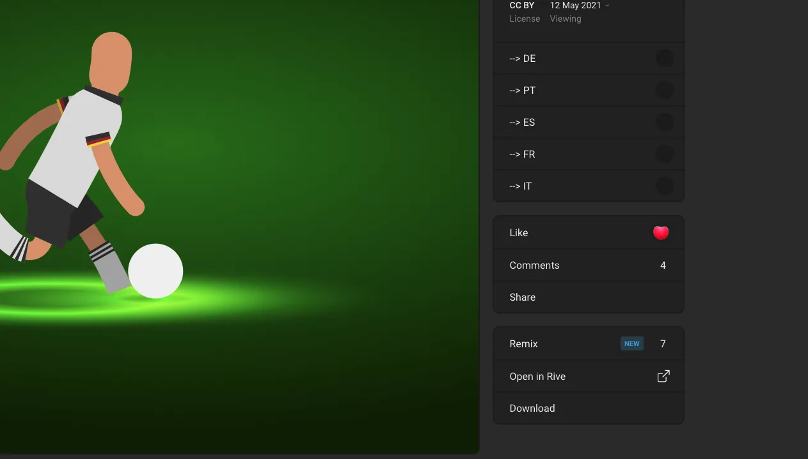

The [Rive Marketplace](https://rive.app/marketplace?utm_source=docs&utm_medium=content) is a place where creators can share their files, get feedback, and learn by opening others’ files directly in the Rive editor.

Marketplace files are all shared under a [CC BY](https://creativecommons.org/licenses/by/4.0/) license.

## Remixing

A Remix is a copy of another user's file. It uses their file as a starting point for a new file in your account. Remixing encourages sharing, and you'll probably learn some new techniques too!

To Remix a file from the Marketplace, find one you like, click on the thumbnail, and use the remix button on the right side.

The file will open in the editor, and a new copy is added to your file browser.
