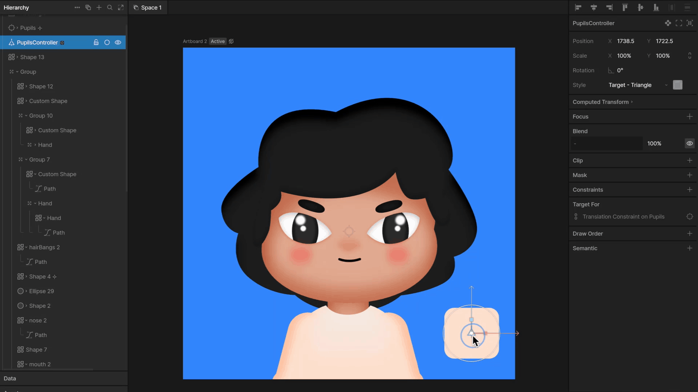

import { YouTube } from '/snippets/youtube.mdx'
import { Demos } from "/snippets/demos.jsx";
import { VideoEmbed } from '/snippets/video-embed.jsx'

<YouTube id="jYW0WuvEw_4" />

Constraints are a way to control the properties of an object through another target object. Some constraints can set limits on these properties (and their hierarchical relationships), while others can copy properties from one object to another.

## Learn by example

<Demos examples={["constraints", "ikConstraint"]} />

## Common use cases

- Make a character's eyes follow a target.

- Ensure a character's feet stay planted on the floor while their legs automatically bend at the knees.

<VideoEmbed src="https://static.rive.app/video/constraints-ik-legs-feet-planted.mp4" />

- Make all the wheels on a vehicle rotate together.
- Make the hands on a clock rotate.
- Copy translation, rotation, or scale from another object.
- Push an object away as one gets closer, or ensure an object always stays close to another one.

Types of constraints in Rive:
- [IK Constraint](/editor/constraints/ik-constraint)​
- [Distance Constraint](/editor/constraints/distance-constraint)
- [Transform Constraint](/editor/constraints/transform-constraint)​
- [Translation Constraint](/editor/constraints/translation-constraint)
- [Scale Constraint](/editor/constraints/scale-constraint)
- [Rotation Constraint](/editor/constraints/rotation-constraint)
