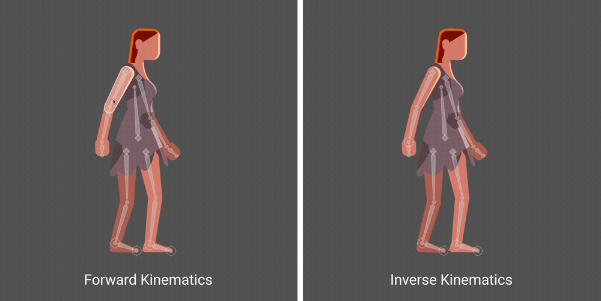
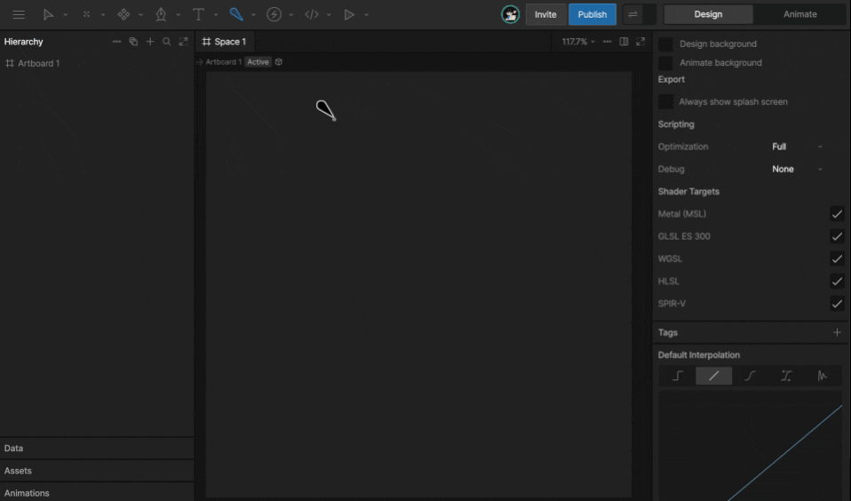
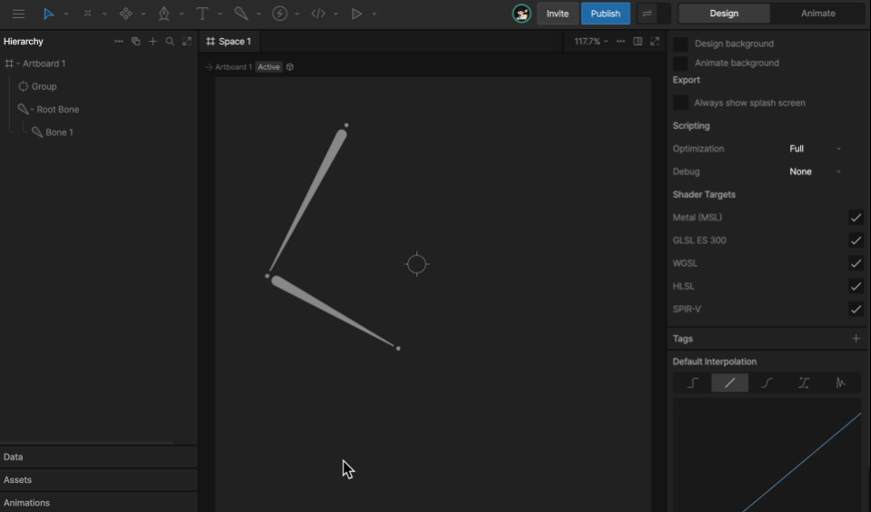
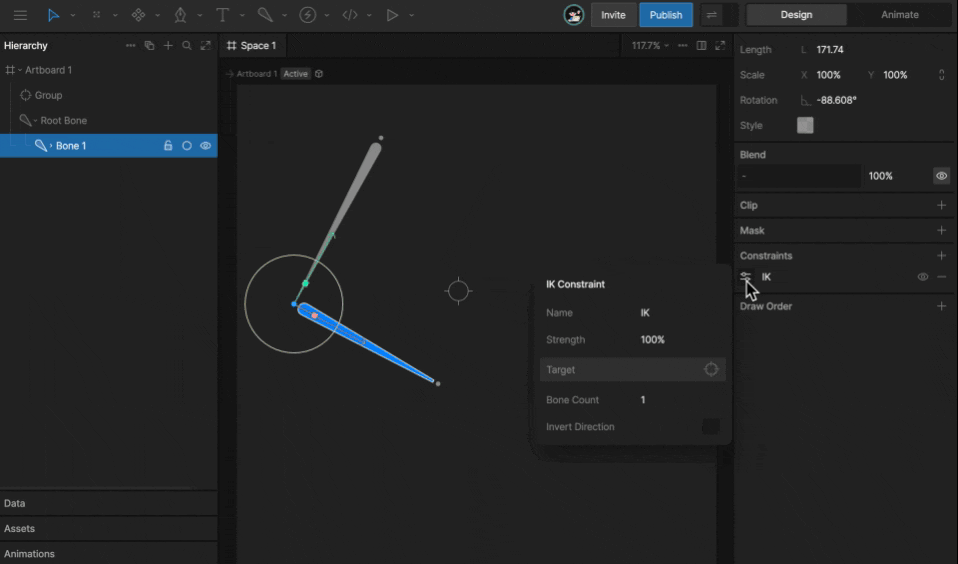
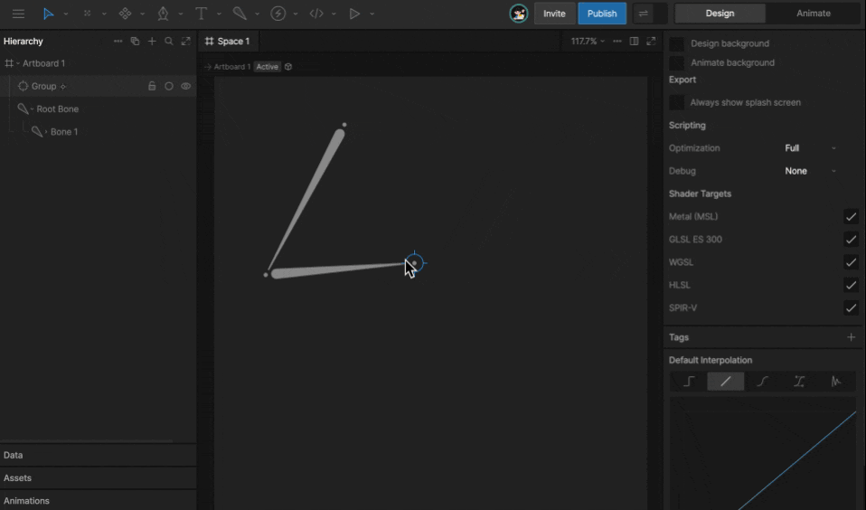
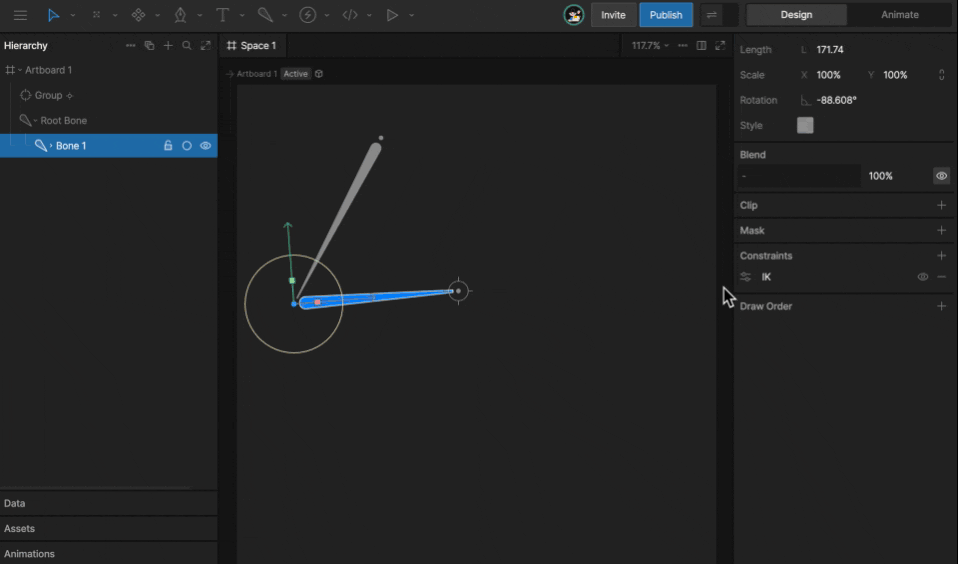
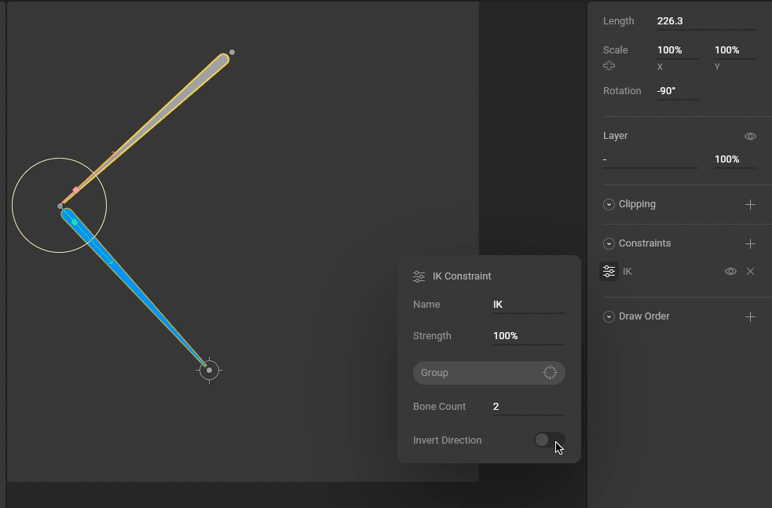
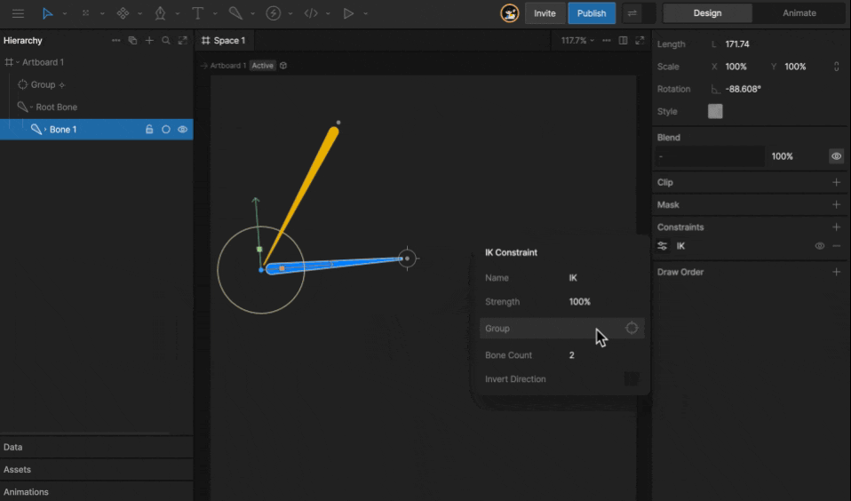
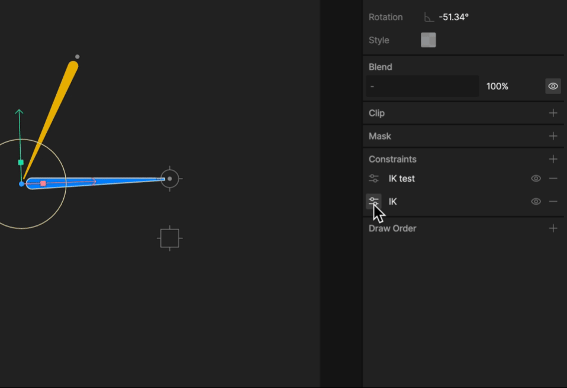
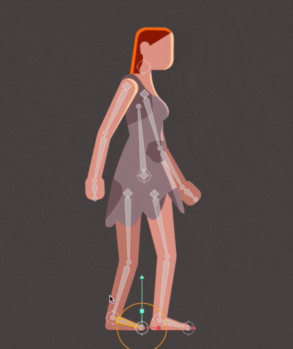

import { YouTube } from '/snippets/youtube.mdx'
import { Demos } from "/snippets/demos.jsx";

<YouTube id="8FK5E5WBUpM" />

## Forward vs inverse kinematics

Most skeletal animation in Rive uses **Forward Kinematics**. With Forward Kinematics, you pose a bone chain by rotating each bone. Child bones move based on the rotation of their parents.

**Inverse Kinematics** works in the opposite direction. Instead of rotating each bone manually, you place a target at the end of the chain and Rive solves the bone rotations needed to reach it.

IK is useful for rigs where the end of a chain needs to follow something else. For example, you might use IK to make a character point at an object or keep a character's feet planted on the ground.

<Demos examples={["ikConstraint"]} />

## Creating an IK Constraint

To use IK, you need a bone chain and a target. The target can be any object, though in most cases you'll want to use a group with its [Style set to Target](/editor/fundamentals/groups#group-style).

<Steps>
    <Step title="Create a bone chain and a target">
        Use the **B** shortcut to create a [bone chain](/editor/manipulating-shapes/bones#how-to-create-bones).

        Then use the **G** shortcut to create a [group](/editor/fundamentals/groups).

        With the group selected, set **Style** in the Inspector to **Target**. A target group stays selectable, even when other objects are above it. See [Targets](/editor/fundamentals/groups#target).

        
    </Step>
    <Step title="Add an IK constraint">
        Select the last bone you want the IK constraint to affect. In the Inspector, use the **Constraints** section to add an **IK** constraint.

        
    </Step>
    <Step title="Select a target">
        Open the constraint flyout menu and use the target button to select the target group you created in step 1.

        
    </Step>
    <Step title="Test the IK system">
        Move the target group. The affected bones should rotate toward the target.

        
    </Step>
</Steps>

## IK properties

### Bone count

Use **Bone Count** to set how far up the bone chain the IK constraint should reach.

When the target is selected, bones affected by the IK constraint are highlighted.

### Invert direction

Use **Invert Direction** to swap the angle used to solve the IK chain.

### Strength

Use Strength to control how much the affected bones follow the target. A Strength of 0% means the target does not affect the bones.

Strength can be animated like most properties in Rive. This is useful for blending between Forward Kinematics and Inverse Kinematics, or for blending between multiple IK constraints with different targets.

### Constraints order

The order of constraints matters. If a bone has two IK constraints and both have a Strength of 100%, the lower constraint overrides the one above it.

If the constraints use lower Strength values, Rive blends between them. Drag constraints in the Inspector to change their order.

## Multiple IK Constraints and nested targets

You can use multiple IK constraints to create more complex rigs.

For example, a character leg might use one IK constraint on the foot and another IK constraint on the leg bones. The leg target can be a child of the foot target, so moving the foot target also moves the leg target.

