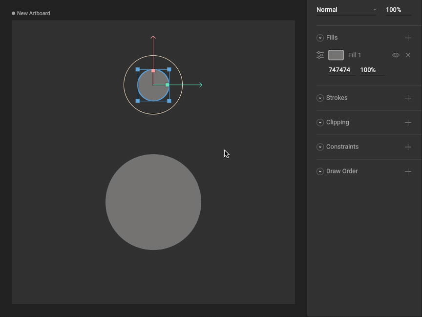
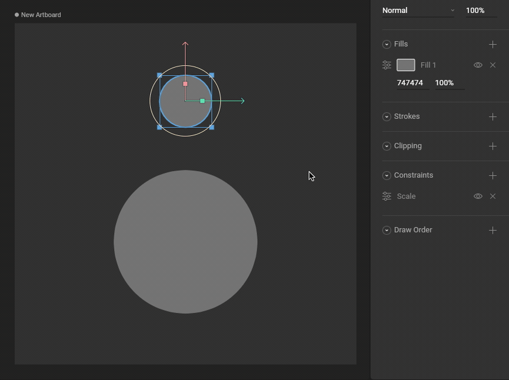
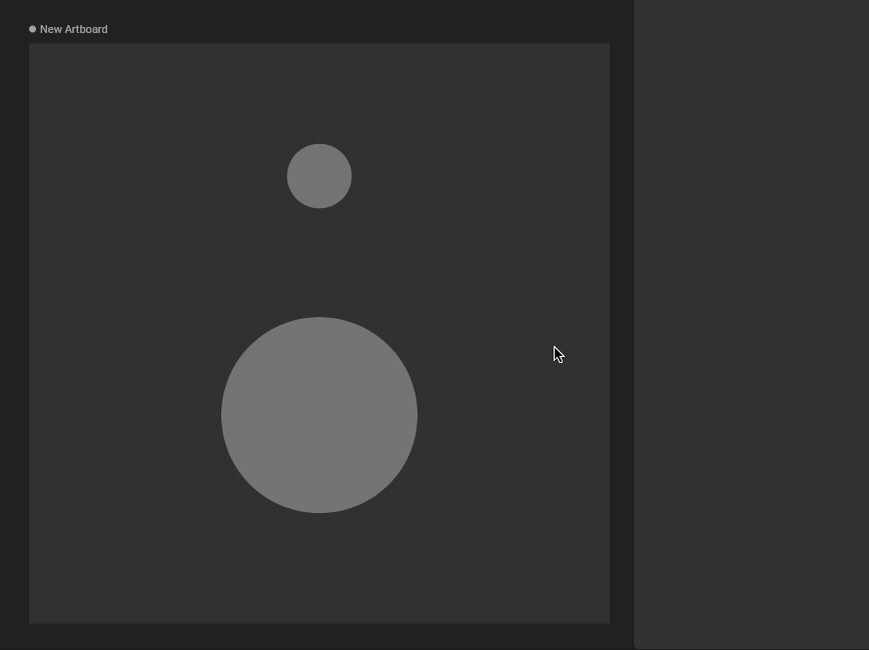

import { YouTube } from '/snippets/youtube.mdx'
import { Demos } from "/snippets/demos.jsx";

<YouTube id="4fFuGQHAiIQ" />

<Demos examples={["constraints"]} learnByExample />

## How to create a Scale Constraint

<Steps>
    <Step title="Add a Scale Constraint to an object">
        Use the Constraints section of the Inspector to add a Scale Constraint to an object.

        
    </Step>
    <Step title="Choose a target">
        

        Use the new constraint's fly-out menu to select a target for this constraint.

        
    </Step>
    <Step title="Test that the Scale Constraint is working">
        Manipulating the target object now causes the constrained object to Scale properties.
    </Step>
</Steps>

## Strength

The Strength property determines how much the constrained object is affected.

A Strength of 0% means the constraint won't have any effect.

A Strength of 50% means half the value from the target will be applied.

## Transform Space

### Source Space

Choose whether this constraint should use World or Local coordinates for the Source Space.

### Destination Space

Choose whether this constraint should use World or Local coordinates for the Destination Space.

### Min/max space

Choose whether this constraint should use World or Local coordinates for the Min/Max Space.