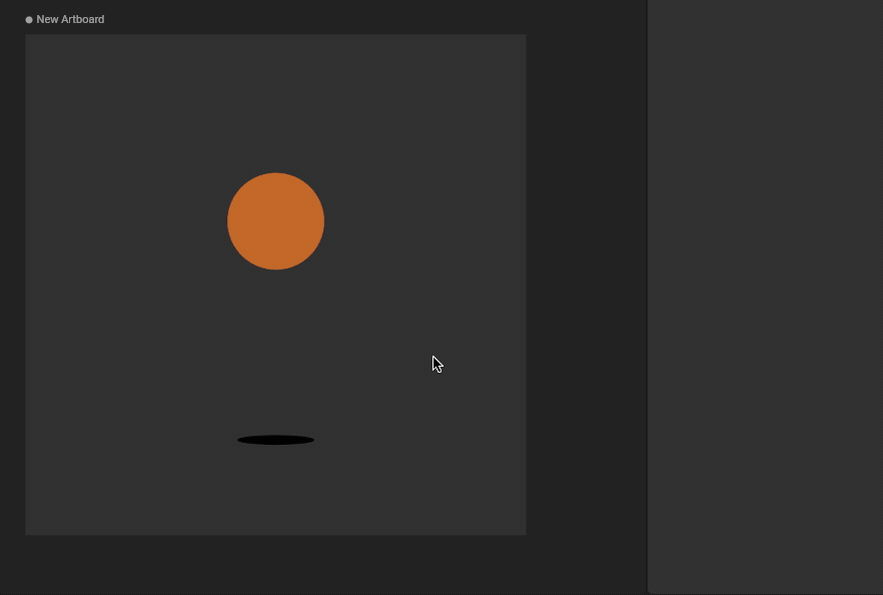
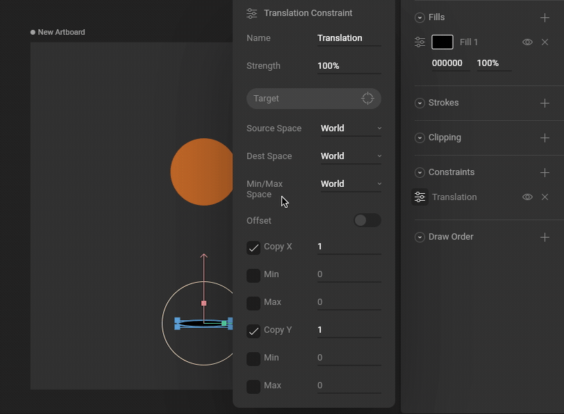
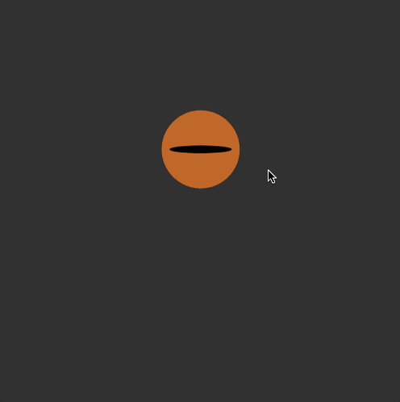
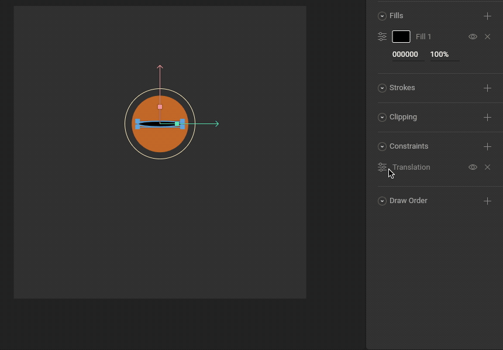

import { YouTube } from '/snippets/youtube.mdx'
import { Demos } from "/snippets/demos.jsx";

The Translation Constraint allows you to set limits on an object's position and/or copy the position properties from a target object. These properties can be independently activated.

<YouTube id="i6OAPcqcPBw" />

<Demos examples={["constraints"]} learnByExample />

## How to create a Translation Constraint

<Steps>
    <Step title="Add a Translation Constraint to an object">
    Use the Constraints section of the Inspector to add a Translation Constraint to an object.

        
    </Step>
    <Step title="Choose a target">
    Use the new constraint's fly-out menu to select a target for this constraint.

        
    </Step>
    <Step title="Test that the Translation Constraint is working">
        Manipulating the target object now causes the constrained object to copy Position properties.

        
    </Step>
</Steps>

## Strength

The Strength property determines how much the constrained object is affected.

A Strength of 0% means the constraint won't have any effect.

A Strength of 50% means half the value from the target will be applied.

## Transform Space

### Source Space

Choose whether this constraint should use World or Local coordinates for the Source Space.

### Destination Space

Choose whether this constraint should use World or Local coordinates for the Destination Space.

### Min/max space

Choose whether this constraint should use World or Local coordinates for the Min/Max Space.

## Offset

Allows the constraint owner to be manually offset from the constraint source.

## Copy X &Y

Allows you to decide if the constraint owner will copy the translation in the X and Y direction. Additionally, use the numerical value to define the rate at which it copies the value.

## Max/min

Use the numerical values to define the minimum and maximum limits of the constraint.