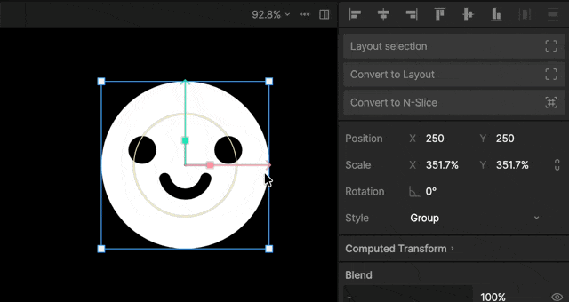
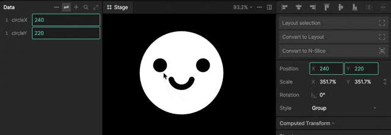
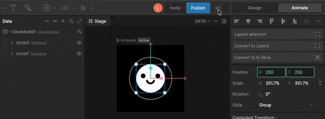
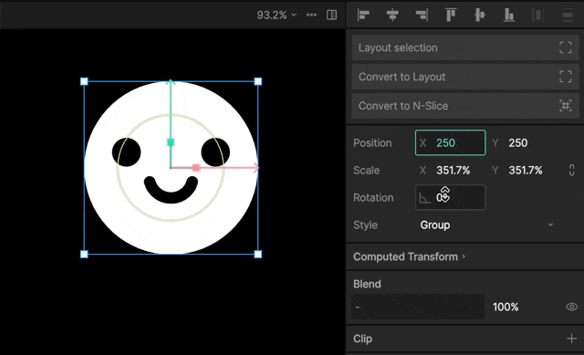
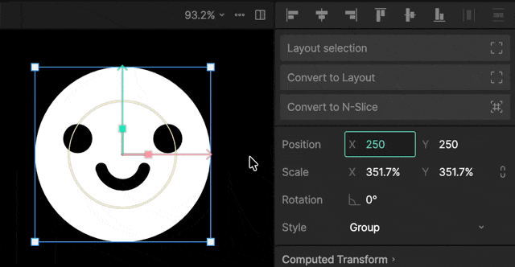
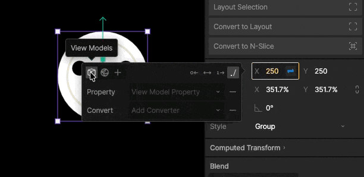
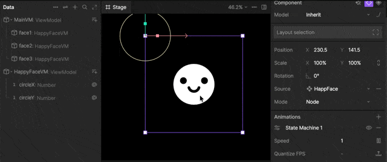
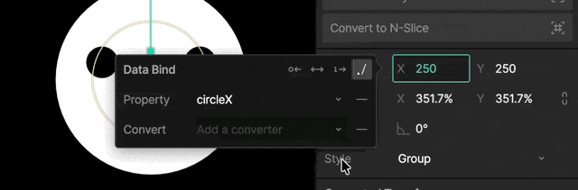

import { YouTube } from '/snippets/youtube.mdx'
import { UseCase } from '/snippets/use-case.mdx'

For example, if you have a `teamName` property bound to a text run in your scene, changing the `teamName` value updates the displayed text automatically.

You can change property values in the editor or at runtime, allowing you to create dynamic experiences that adapt to each user.

Bindings are not limited to visual properties. You can bind values throughout your file, including transforms, animation speeds, [converter values](/editor/data-binding/converters#converter-types), [script inputs](/scripting/script-inputs#data-binding-inputs), [transition condition values](/editor/state-machine/transitions), and more.

This allows the same data to drive behavior, animation, and logic across your scene, helping keep everything in sync.

## Binding a property

Let's control the `X` position of a circle using `circleX`, which is a Number property in our View Model.

<Steps>
  <Step title="Bind the property">
    With your circle selected, right-click the `X` field, and select **Data Bind**.
  </Step>
  <Step title="Select the property">
    In the **Property** dropdown, select `circleX`.
  </Step>
</Steps>

The `X` field should now be highlighted in green, indicating that it's bound to a value.

The circle's horizontal position is now driven by the `circleX` property. Any time the property's value changes, the circle updates automatically.

<Warning>
  If the field has a yellow border, there is a problem with the binding.

  In most cases, the property type is incompatible with the target value. For example, the `X` position of an element can only be bound to a Number property.
</Warning>

<Tip>
  **Previewing Bindings**

  By default, your data only controls your elements when the state machine is playing.

  To preview your data-bound values, turn on the **Data Binding Preview Toggle**.

  
</Tip>

### Creating a property while binding

You can create a new View Model property from the bind popup instead of adding it in the Data panel first.

<Steps>
  <Step title="Open the New Property form">
    Right-click the field, select **Data Bind**, then click the **New Property** (**+**) icon in the popup's header.
  </Step>
  <Step title="Choose a View Model">
    In **Model**, select the View Model to add the property to. To make a new View Model, select **Create New** and enter a name that doesn't match an existing View Model.
  </Step>
  <Step title="Name the property">
    Enter a name in **Property**. Its type matches the field you're binding.
  </Step>
  <Step title="Set a starting value">
    **Value** sets the property's starting value on every instance. It defaults to the field's current value.
  </Step>
  <Step title="Create it">
    Click **Create Property** or press `Enter`. Rive creates the property and binds the field to it.
  </Step>
</Steps>

<Note>
  Only String, Number, Boolean, Color, and Trigger properties can be created here. For other types, such as lists, enums, and assets, create the property in the Data panel.
</Note>

### Updating a binding

Right-click the bound element and select **Update Bind**.

### Removing a binding

Right-click the bound element and select **Unbind**.

### Finding bound objects

In the **Hierarchy**, objects with bound properties show a data bound badge. The arrows show which way data flows, and the badge turns amber when a binding is invalid. Hover the badge to see the bound properties.

If an object has no bindings of its own but something inside it does, it also shows a badge. Expand it to find the bound object.

## Binding options

Each binding has the following properties.

### Property

The View Model property the target is connected to.

<Note>
  When binding global properties, select the **Globals** icon.
  
</Note>

### Path

When binding properties in nested View Models, there may be multiple properties with the same name available.

The path determines which specific property instance the binding should use.

See also [Absolute vs Relative Binding](#absolute-vs-relative-binding).

### Bind direction

By default, the View Model property (**source**) controls the bound element or value (**target**), but it can also work the other way around.

<YouTube id="Syt6i4-Bkm4" />

#### Target to source

When a binding has `Target to Source` toggled on, a change to the element will update the view model property.

<UseCase
  title="Tracking Positions"
>
  Let's say you have a walk cycle animation and you want to track the exact Y position of the head as it bobs up and down.

  With the head's `Y` position bound to `headY` using **Target to Source**, the `headY` property updates automatically as the head moves.
</UseCase>

#### Bidirectional

A change to the view model property will update the element **AND** a change to the element will update the view model property.

Clicking the **Bidirectional** toggle multiple times will cycle between **Bidirectional (prefer target value)** and **Bidirectional (prefer source value)**.

In rare cases, both the source and target may change at the same time. This setting determines which value wins when a conflict occurs.

<UseCase
  title="Checkers"
>
  Let's say you're building a game of checkers and need to create logic for dragging and dropping each piece.

  The initial position of each piece is determined by the `piecePositionX` and `piecePositionY` properties (source to target).

  As the piece is dragged, the piece itself (target) updates those property values (target to source).
</UseCase>

### Bind once

When **Bind Once** is enabled, the binding only applies the value a single time when the scene starts or the binding is created.

After the initial value is applied, future changes to the source or target are ignored.

<UseCase>
  Let's say you're creating a particle effect and want each particle to start with a random rotation value.

  You could bind the particle's rotation to a random number property using **Bind Once**. Each particle would receive its initial rotation value, but future changes to the property would not affect existing particles.
</UseCase>

### Absolute vs relative binding

<YouTube id="4LOXhXesG74" />

By default, new data binding connections are created as absolute binds.

- **Absolute Binding** points to a specific property instance within the View Model hierarchy.
- **Relative Binding** searches for a property with a matching name, starting with the closest View Model and working up the hierarchy.

Because relative bindings resolve by name, a closer property with the same name can take precedence over the property you intended to bind. For example, if a binding targets a property named `scale` in the main View Model, but a closer View Model also contains a property named `scale`, the binding will resolve to the closer property.

<Note>
Bindings to [Global View Models](/editor/data-binding/view-models#global-view-model-instances) are always relative.
</Note>
