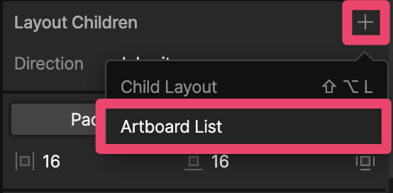
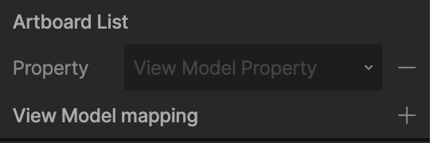
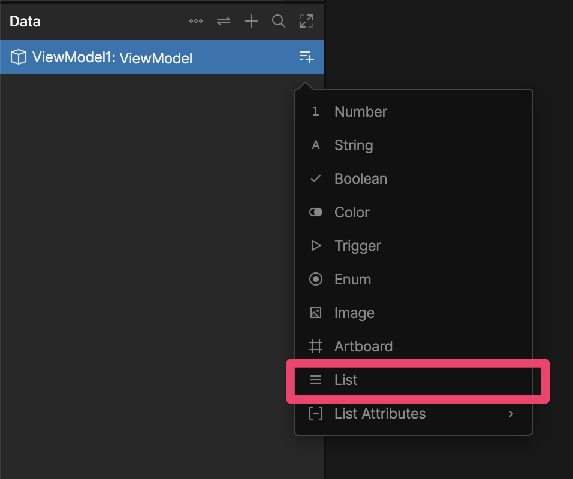
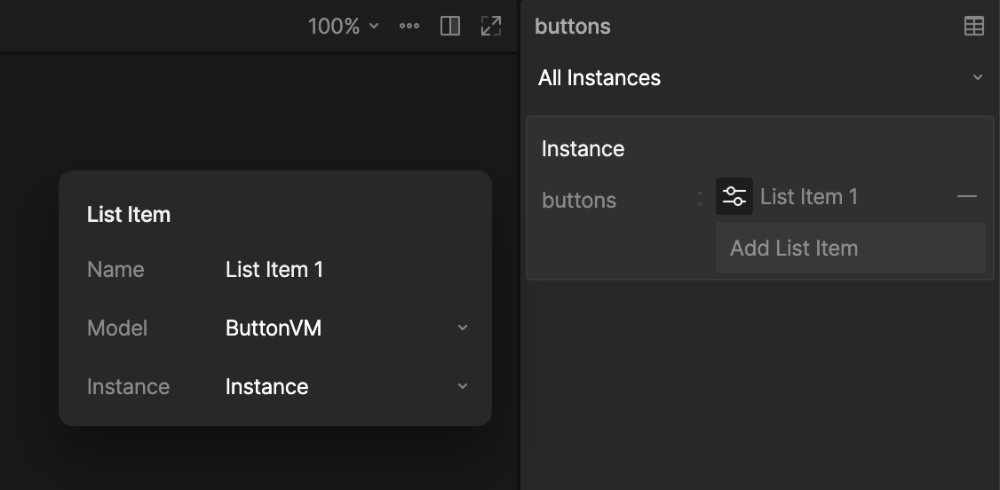
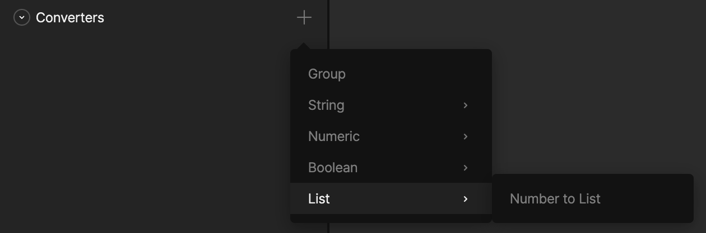
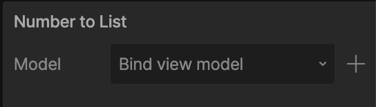
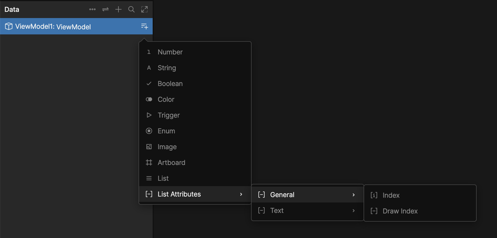

import { YouTube } from '/snippets/youtube.mdx'

<YouTube id="VCWcOtUfIc8" />

A List is a way to display a set of items that are dynamically generated based on bound data values that you set up in your View Models. This allows you to build Rive files that can change in real time based on updates to those values. You can use Lists to create:

- Menus with a dynamic amount of options
- Product listings
- Notifications or activity feeds
- Chat messages
- Dropdown menus
- Contacts, friends, or followers lists
- High scores, tables, and more

---

## Artboard lists

Artboard Lists enable you to generate a number of list items using an Artboard to represent each item in your List. Artboard Lists must be added as children of an Artboard or Layout.

To add an Artboard List to the stage, first select either an Artboard or a Layout. In the inspector on the right side of the editor, you will see a button to add an Artboard List. Click it to add the List to your hierarchy. It will appear as a child of the Artboard or Layout you had previously selected.

Once the Artboard List is added to your hierarchy, you can select it and see its inspector.

The next step is to bind data to it using Data Binding. This will determine the content and number of items in your List. There are 2 ways to generate List content:

- Using the View Model List property
- Using a View Model Number property together with a Number to List converter

### View Model mapping

By default, each list item is drawn with the Artboard its View Model is bound to. To use a different Artboard, select the Artboard List and click `+` in the **View Model mapping** section of the inspector. Then choose a View Model and the Artboard that should draw list items of that type.

## View Model list property

<Note>
  Before continuing, it's important to understand the fundamentals of Data Binding, in particular, what a View Model is, how to create one and how to bind it to an object's properties. Learn more in the [Data Binding Overview](/editor/data-binding/overview).
</Note>

A View Model List is a property that can contain a dynamic number of items which each represent a View Model instance. In order to be used in a List, the View Model must be bound to an Artboard.

To Create a View Model List and bind it to an Artboard List:

<Steps>
  <Step title="Create a List Item View Model">
    Navigate to the Data tab in the Editor. Click the + button beside View Models to create a View Model (this will represent your List item)
  </Step>
  <Step title="Bind the List Item View Model to your Item Artboard">
    Bind that View Model to an Artboard that you want to use to render your List item. This is where you may also want to create additional View Model properties and bind those to object properties on that Artboard.
  </Step>
  <Step title="Create your Main View Model">
    Click the + button beside View Models to create another View Model (this will be the View Model that contains your List and should be bound to the Artboard where you want your List to render)
  </Step>
  <Step title="Add a List property">
    Select the newly created View Model and click the + button next to it. From the popout select **List**. This adds a List property to the View Model 
  </Step>
  <Step title="Add List Items">
    Select the List property and in the inspector on the right, you can add items by clicking Add List item  Once a List item is added, you can click the settings button to the left of its name in order to set the View Model and View Model instance for that item
  </Step>
  <Step title="Bind the List property to your Artboard List">
    After adding your List items, go back to the Hierarchy tab, select the Artboard List, and from the Artboard List property dropdown, select the ViewModel List property you created above.
  </Step>
</Steps>

To remove the binding, click the delete button next to the Artboard List property dropdown.

Run the state machine and you should see your list items. Remember that the layout will be determined by the Artboard List's parent, so modify the parent's settings in order to tweak your List's layout

<Note>
  Rive's runtimes provide [APIs to modify the List and List items at runtime](/runtimes/data-binding#lists) (for example, adding or removing items).
</Note>

## View Model number with Converter

The second way to populate your list is by specifying the number of items you want in your List along with the ViewModel (Artboard) you want to instance. This can be done using a View Model Number property in combination with the new Number to List converter.

To Create a View Model Number to List converter and bind it to an Artboard List:

<Steps>
  <Step title="Create a List Item View Model">
    Navigate to the Data tab in the Editor. Click the + button beside View Models to create a View Model (this will represent your List item)
  </Step>
  <Step title="Bind the List Item View Model to your Item Artboard">
    Bind that View Model to an Artboard that you want to use to render your List item. This is where you may also want to create additional View Model properties and bind those to object properties on that Artboard.
  </Step>
  <Step title="Create your Main View Model">
    Click the + button beside View Models to create another View Model (this will be the View Model that contains your Number property and should be bound to the Artboard where you want your List to render)
  </Step>
  <Step title="Add a Number property">
    Select the newly created View Model and click the + button next to it. From the popout select Number. Select the newly created Number and in the inspector, set the number of items you want in your List
  </Step>
  <Step title="Add a Number to List converter">
    Click the + button and choose **Converters \> List \> Number to List**. 
  </Step>
  <Step title="Set the View Model to use in the converter">
    Select the created converter and in the inspector, choose the View Model that you created earlier that represents your List item. The converter will convert the Number of items to actual Artboard items 
  </Step>
  <Step title="Bind the Number property and converter to your Artboard List">
    After adding your Number property and converter, go back to the Hierarchy tab, select the Artboard List, and from the Artboard List property dropdown, select the ViewModel Number property you created above. The Combobox will show a yellow outline. Right click the Combobox and choose Update Bind. In the converter field, select the Number to List converter you created. The yellow outline should change to green.
  </Step>
</Steps>

Run the state machine and you should see your list items. Remember that the layout will be determined by the Artboard List's parent, so modify the parent's settings in order to tweak your List's layout

## List attributes

List attributes are special View Model properties that connect a list item to its List. To add one, click the `+` button next to your item's View Model and select **List Attributes**.

The **General** group contains attributes any list item can use:

- [**Index**](#view-model-list-item-index): the item's position in its parent List.
- [**Draw Index**](#view-model-list-item-draw-index): a number that sets the item's draw order.

The **Text** group contains attributes for [text lists](#text-list-attributes).

### Text list attributes

A text can build its runs from a list. Select the text, then use **Bind** in the **Text Runs** section of the Inspector to bind a View Model List property. Each list item becomes a text run.

Add these attributes to the item's View Model from **List Attributes \> Text** to set each run's text and style:

- **Text Content**: a String that sets the run's text.
- **Text Style**: a String naming one of the text's styles to apply to the run. If no style has that name, the run uses the first style.

<Tip>
  In the Data panel, click **+** and select **View Model \> Templates \> Text Run** to create a View Model that already has both attributes.
</Tip>

## View Model list item index

There may be times where it is useful for the Artboard to know at which index it exists within its parent List. This is available using the View Model list item index property.

<YouTube id="CHXIOKQOq6Y" />

This can be added to your item's View Model by clicking the + button and selecting **List Attributes \> General \> Index**.

This property can then be bound to an object's properties and used directly (for example, to change the position of an object based on the index), used together with a converter (to display the index value as a string) or used as a condition in a state machine (to provide different behavior depending on the item's index).

<Info>
  When using item index with the [List property](/editor/data-binding/lists#view-model-list-property) and list items, be aware that if more than 1 list item is bound to the same View Model instance, they will share the same index value
</Info>

## View Model list item draw index

By default, a List draws its items in list order. To control the draw order yourself, add a draw index to your item's View Model by clicking the + button and selecting **List Attributes \> General \> Draw Index**.

Draw Index is a Number property. When your item's View Model has one, the List draws its items in ascending draw index order instead of list order. Bind or change the value to bring items in front of or behind each other.

## Lists & scrolling

If you add your Artboard List as a child of a Layout, your List items will behave as children of its parent's Layout. This means things like direction, wrapping, padding, gap, alignment, etc. are all dictated by the parent Layout's properties.

In addition, if you have applied a [Scroll Constraint](/editor/constraints/scroll-constraint) to the parent Layout, the List items will have the ability to scroll out of the box without any additional setup.

There are additional Scroll properties that can be applied when scrolling Lists. See [List Scrolling](/editor/constraints/scroll-constraint#scrolling-a-list) for more details.