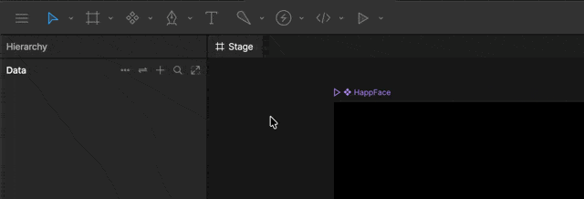
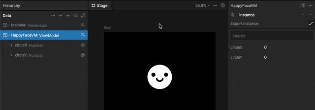
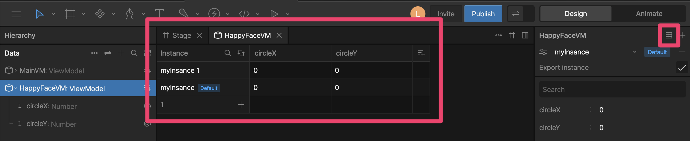
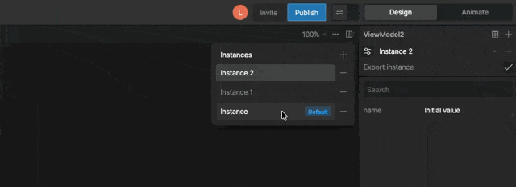
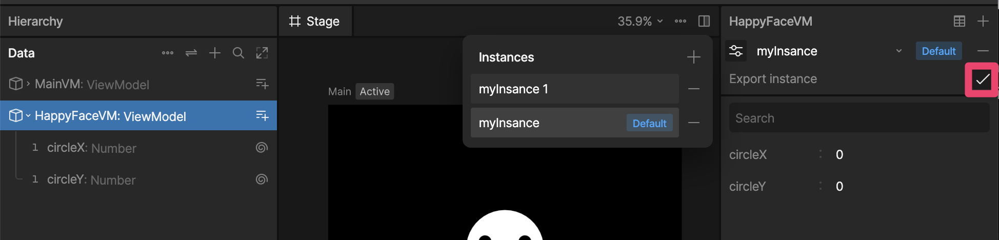
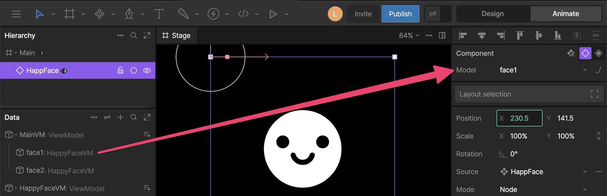
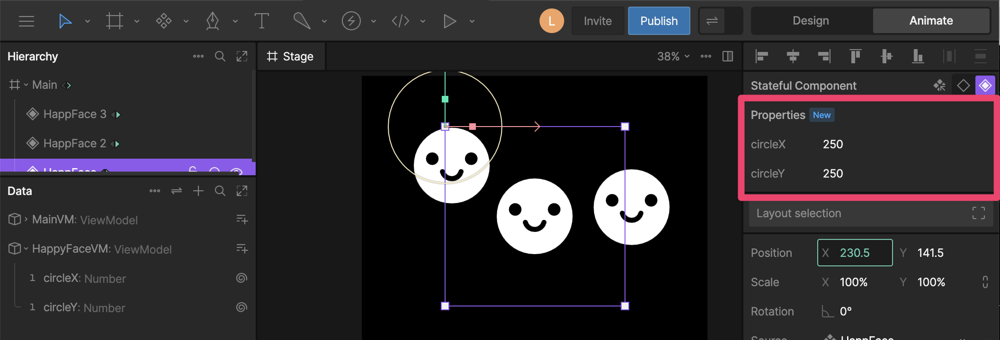

import { UseCase } from '/snippets/use-case.mdx'
import { YouTube } from '/snippets/youtube.mdx'

A View Model defines the structure of your data. It acts as a reusable blueprint that contains a collection of properties, such as a car's color, speed, and damage.

Each property has a type, such as Number, String, Boolean, Color, Enum, or List (For more information, see [View Model Properties](/editor/data-binding/view-model-properties)).

View Models do not store values themselves. Instead, values are stored in one or more View Model Instances that are created from the View Model.

For example, if you were building a racing game, you might create a Car View Model with the following [properties](/editor/data-binding/view-model-properties):

```jsx
Car (View Model)
  color: Color
  damage: number
  make: string
  speed: number
```

A single View Model can be used to create many View Model Instances. Each instance shares the same structure but stores its own values.

```jsx
Car1 (View Model Instance)
  color: 0xFFFF0000
  damage: 0
  make: "Subaru"
  speed: 0

Car2 (View Model Instance)
  color: 0xFFFF00FF
  damage: .9
  make: "Honda"
  speed: 0
```

The properties in your instances can then be bound to elements in your designs, allowing text, images, colors, animations, state machines, and other properties to react to data changes automatically.

### Creating a View Model

A View Model defines the structure of your data. Before creating View Model Instances or setting up data bindings, you'll first need to create a View Model and add properties to it.

<Note>
  New Rive files come with a default view model called "ViewModel1" that is already attached to the main artboard.
</Note>


<Steps>
  <Step title="Add a View Model">
    In the Data panel, click the `+` icon and select **View Model** or [**Global View Model**](#global-view-model-instances).
  </Step>
  <Step title="Add Properties">
    In the Data panel, click the **Add View Model Property** button next to the view model name and select your [property type](/editor/data-binding/property-types).
  </Step>
</Steps>



## Working in the Data panel

### Templates

Templates add a View Model that's already set up for a common use. In the Data panel, click the `+` icon and select **Templates**:

- **Text Run** adds a View Model with text and text style properties, ready to bind to a text run.

### Searching

Use the search field in the Data panel to filter it by name.

### Private properties

Properties whose names start with an underscore (`_`), such as `_internalState`, are private. They're hidden from the Data panel's preview by default.

To show them, open the Data panel's header menu and check **Private properties** under **Preview**.

## Creating and editing instances

Once your View Model has been created, you can create one or more View Model Instances that store actual values for those properties.

### Creating a View Model instance

A View Model can have multiple instances. Each instance contains its own set of property values while sharing the same structure defined by the View Model.

<Note>
When creating a new View Model, Rive automatically creates a View Model Instance named "Instance" so you can immediately begin testing bindings and previewing data.
</Note>



<Steps>
  <Step title="View existing instances">
    Select a View Model in the Data panel, then click the Controls icon next to the instance name in the Inspector.

    <Tip>
      To see all of your view model instances and values at once, click the Open Table Data button.

      
    </Tip>
  </Step>
  <Step title="Add an instance">
    Click the `+` icon to add a new instance.
  </Step>
  <Step title="Name the instance">
    Double click the instance's name to rename it.
  </Step>
  <Step title="Update the instance data">
    With the instance selected, change any of its properties.

    Note that this changes **only** the values on the selected view model instance.
  </Step>
</Steps>

### Removing instances

Click the `-` icon next to the instance name to delete it.



<Note>
  Deleting a View Model Instance does not remove the View Model or its properties. It only removes that instance and its stored values.
</Note>

To clean up a View Model, right-click it in the Data panel and select **Delete Unused Instances**. This deletes the View Model's instances that nothing in the file uses. Rive shows how many will be deleted before you confirm.

### Exporting instances

By default, exported View Model Instances are included in the .riv file. Disable Export Instance when the data is only needed during development, not in your application at runtime.



<UseCase title="High Score">
  Let's say you're building a high score screen in Rive. While designing, you'll use fake score data, but when your game is live, the high scores will be populated using real data from a database or another source.

  In this case embedding the example data just increases your .riv file size.
</UseCase>

### Using the data table

The data table shows all of a View Model's instances and their values at once. To open it, right-click a View Model in the Data panel and select **Open Data Table**, or click the **Open Table Data** button in the Inspector.

By default, each row is an instance and each column is a property. Use the table's toolbar to change the view:

- **Search** filters the table's instances by name. When the axes are flipped, it filters properties instead.
- **Flip Axes** swaps rows and columns, so instances run across the top and properties run down the side.
- **Tag Display** sets how [tags](/editor/tagging) show on instances and properties: **Expanded** shows their names, **Collapsed** shows colored dots, and **Off** hides them.

Right-click an instance or property header for more options:

- **Filter Instance** or **Filter Property** shows only that instance or property.
- **Open Data Table** on a [View Model property](/editor/data-binding/property-types#view-model) opens the table for the View Model it uses.

For [List](/editor/data-binding/lists) properties, click the expand button in the cell to show or hide the list's items.

### Comparing a property across instances

Select one or more properties in the Data panel to see and edit their values in the Inspector. By default, the Inspector lists the values in every instance of the View Model.

Use the **Instance** menu to show **All Instances** or only one. Click the **Open Data Table** button to open the selected properties in the [data table](#using-the-data-table).

## Connecting View Model instances to Artboards

Before binding data, you'll need to decide where the data should live.

Rive supports a few common patterns:

| Pattern |	 |
| :------------- | :----------- |
| [Global Instances](#global-view-model-instances)	| Global view models and their properties are directly accessible to all artboards |
| [Instances attached to artboards](#instances-attached-to-artboards)	| The view model instance is attached to the artboard and its values can be used by that artboard and its children |
| [Instances as nested properties](#instances-as-nested-properties) |	The parent view model instance stores a reference to a nested view model instance |
| [Stateful nested components](#stateful-components) |	Self-contained, reusable components that store their own unique data |

### Global View Model instances

Global View Models provide data that can be accessed throughout your Rive file.

Under the hood, global view models are not connected to a specific artboard. Instead, the view model instance and its properties are directly accessible to all artboards.

<YouTube id="SPrxwHfPyP4" />

Bindings to Global View Model properties are always **relative bindings**. This means the binding searches for a property with the same name starting from the closest View Model, rather than pointing directly to the global property.

If a closer View Model contains a property with the same name, that property will be used instead. For example, a binding to a global `scale` property will resolve to a `scale` property on a closer View Model if one exists.

Learn more about [Absolute vs Relative Binding](/editor/data-binding/binding-data#absolute-vs-relative-binding).


### Instances attached to Artboards

View Model instances can be attached to a specific artboard or nested component. This is useful when only that artboard and its children need access to that data.

```
EnemyVM
├─ health
```

<UseCase title="Game">
An Enemy view model might contain a `health` property. This property might be used by the enemy itself, but not by its parent.
</UseCase>

### Instances as nested properties

View Models can have properties that are View Model instances.

In this pattern, the parent View Model stores references to child instances, either directly or through a [list](/editor/data-binding/lists).

```
GameVM
├─ health
└─ score
└─ avatar
└─ inventory (stores an instance of InventoryVM)

InventoryVM
├─ Sword
├─ Shield
└─ Potion
```



This approach is useful when a parent artboard needs to manage a collection of items while still allowing each component to maintain its own data.

<UseCase title="Inventory Grid">
An inventory screen might contain a list of Item View Model Instances, with each inventory slot component bound to a different item.
</UseCase>

### Stateful components

A stateful component is an instance of a component that maintains its own data.

Unlike traditional component View Model Instances, these instances do not need to be created or referenced by the parent View Model. Instead their properties are exposed in the sidebar.



For more information, see [Stateful Components](/editor/data-binding/stateful-components).

## Naming conventions

Workspace admins can set the casing that names should follow across the workspace. Open the [workspace admin](/account-admin/workspaces/managing-workspaces#workspace-admin) and select the **Options** tab:

- **View model naming convention** applies to View Model and enum names. The default is `PascalCase`.
- **View model property naming convention** applies to View Model property names. The default is `camelCase`.

Choose `PascalCase`, `camelCase`, `snake_case`, `kebab-case`, or **None**. Names that don't match are listed in the [Problems](/editor/interface-overview/debug-panel#problems) tab, and the AI Agent follows the convention when it creates names.


