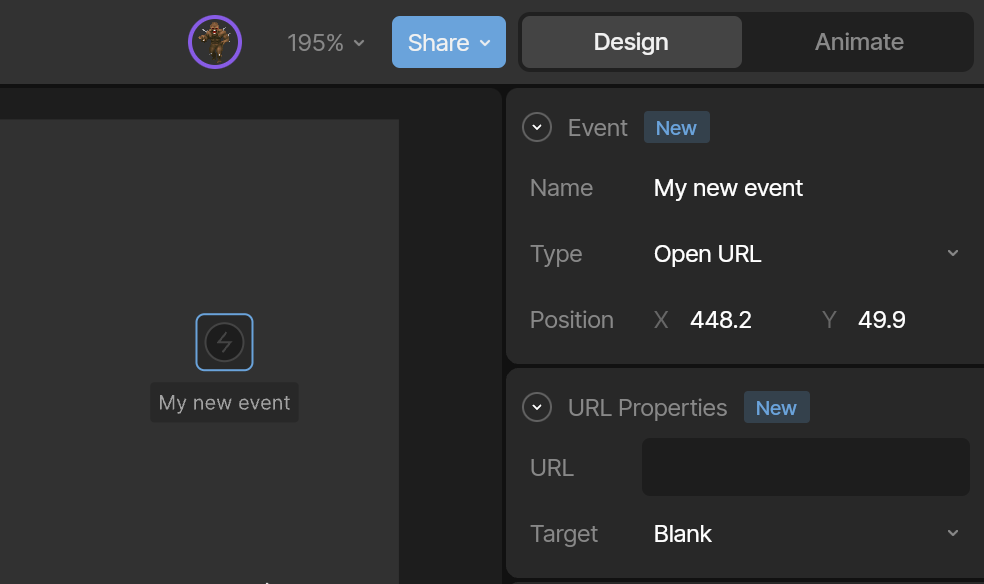

<Warning>
  Open URL Events are not supported on Apple or Android runtimes.
</Warning>

<Note>
  For security reasons, Open URL Events are disabled by default in web runtimes.

  To enable them, set `automaticallyHandleEvents` to `true`.
</Note>

<Note>
  For security reasons, Open URL Events are disabled in share links and on the Rive Marketplace.
</Note>

For general information about adding, creating, and signaling events, see [Rive Events](/editor/events/overview).

### URL properties

When you select the **Open URL** Event type, additional configuration options become available.

Enter the URL you want to open.

<Info>
  Include the URL protocol (for example, `http://` or `https://`) when linking to external domains.
</Info>

The **Target** determines where the URL opens in the browser.

- `Blank` — Opens the link in a new tab or window, depending on browser settings.
  **Note:** If the Event is not triggered by a user interaction (for example, via a Listener), the browser may block it as a popup.
- `Parent` — Opens in the parent browsing context. If no parent exists, behaves like `Self`.
- `Self` — Opens in the current browsing context.
- `Top` — Opens in the topmost browsing context. If no ancestor exists, behaves like `Self`.

<Info>
  For security reasons, URLs are not opened by default in embeds or Marketplace posts. This behavior may change in the future.
</Info>

### Properties (deprecated)

Properties allow an Event to carry additional data to the runtime.

This feature is deprecated and has been replaced by [Data Binding](/editor/data-binding).
