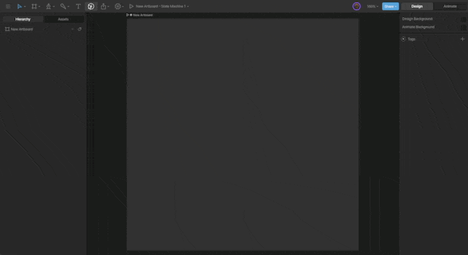
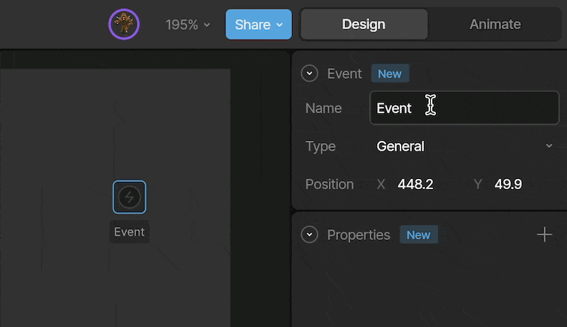
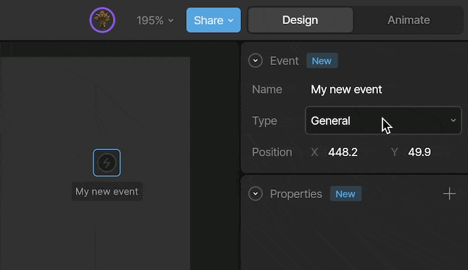
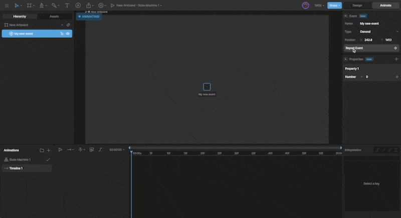
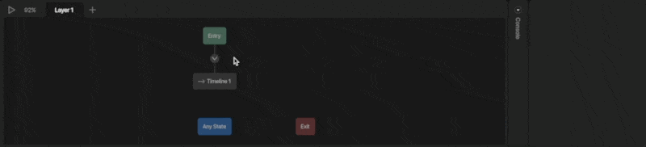
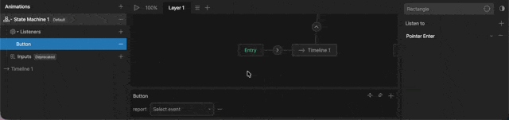

import { YouTube } from "/snippets/youtube.mdx";

Events live within an artboard and are used to signal that something has happened. They can be fired from timelines, states, transitions, or listeners, and a [listener](#listening-for-an-event) can respond when an event fires.

Rive supports three types of Events:

- [Open URL Event](/editor/events/open-url-events) — Opens a URL at runtime
- [Audio Event](/editor/events/audio-events) — Plays a sound
- General Event — Signals that something happened, with no built-in behavior. Use it to trigger a listener.

<Note>
  Using events to send information to runtime code is deprecated. Use [Data Binding](/editor/data-binding/overview) instead. See [Events at Runtime](/editor/events/general-events) for legacy projects.
</Note>

## Creating an event

<Steps>
  <Step title="Create an Event">
    Use the Events tool located in the Toolbar and click anywhere on the artboard.

    

    You'll notice that the Event is displayed on the artboard and in the Hierarchy.
  </Step>
  <Step title="Name your Event">
    Give your event a name so it’s easy to identify and reference.

    You can rename it using the **Name** field, or by double-clicking the name directly on the artboard.

    
  </Step>
  <Step title="Select an Event type">
    The Type dropdown allows you to change the Event type between Audio, URL, and General.

    
  </Step>
  <Step title="Set your Event Properties">
    Each Event type has its own set of properties.

    For more information on the specific event types, see [Open URL Events](/editor/events/open-url-events) and [Audio Events](/editor/events/audio-events). Custom properties on General Events are only used by runtime code, which is deprecated. See [Events at Runtime](/editor/events/general-events).
  </Step>
</Steps>

<Tip>
  If events aren't visible on the stage, open the **View Options** menu and make sure **Events** is enabled.
</Tip>

## Signaling an event

We can signal an Event in four ways: from a timeline, a listener, a state, or a transition.

### Timeline

Signaling an Event from the timeline lets you control the exact moment in an animation when the Event fires.

First, select the timeline you want to add the Event to. Then use the **Report Event** button in the Inspector.

### Transition & state

You can report an event on a Transition or a State. To report an event, select the desired State or Transition and use the `+` button next to the Events section in the Inspector.

Now that we've selected the Event, we can decide whether it is signaled at the start or end of the Transition or State.

### Listeners

With your [Listener](/editor/state-machine/listeners) selected, click the `+` below the State Machine Graph, and select **Report Event**.

## Listening for an event

A [listener](/editor/state-machine/listeners) can respond when an event fires, then run actions such as changing a value or reporting another event.

<Steps>
  <Step>
    Create a listener in the State Machine and set its target to the artboard or nested component that contains the event.
  </Step>
  <Step>
    Set **Listen to** to **Rive Event**, then select the event.
  </Step>
  <Step>
    Add the actions you want to run when the event fires.
  </Step>
</Steps>

The listener target must be an artboard or nested component, not an element. See [Rive Event listeners](/editor/state-machine/listeners#rive-event) for details.

<Tip>
  To communicate between artboards, such as between a parent artboard and a nested component, we recommend [Data Binding](/editor/data-binding/overview) instead of events.
</Tip>
