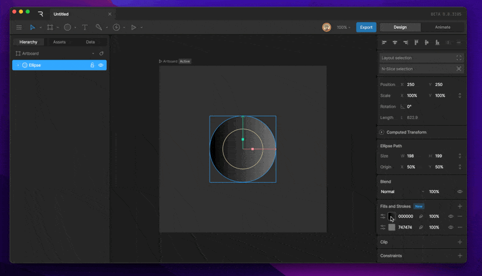
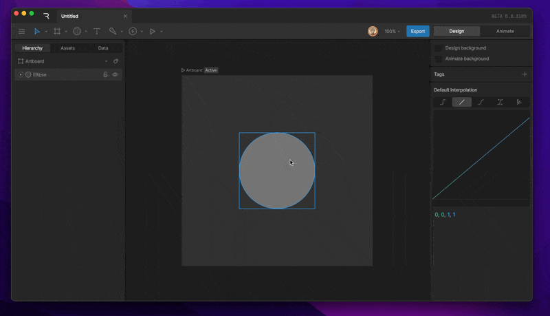
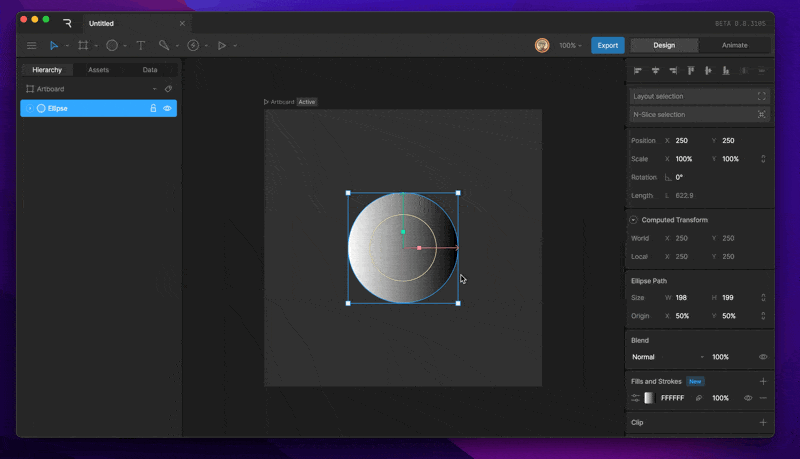
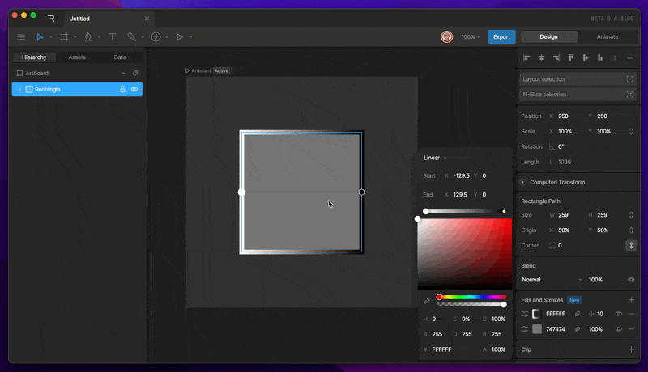
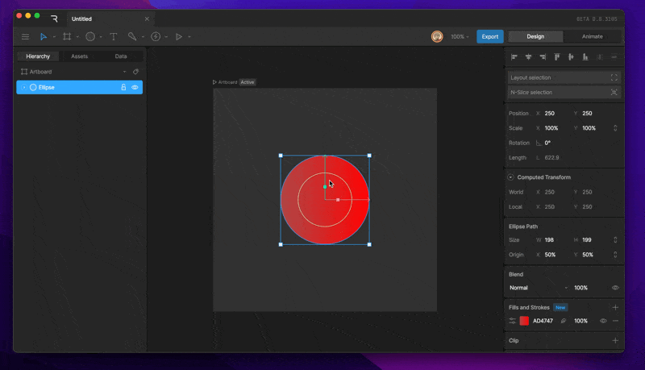

Every [fill and stroke](/editor/fundamentals/fill-and-stroke) has a paint, which can be a solid color, a gradient, an image, or an artboard. Click a fill or stroke's swatch in the Inspector to open the color picker.

## Choosing a paint type

The dropdown at the top of the color picker sets the paint type:

- **Solid**: A single color.
- **Linear**: A gradient that blends colors along a straight line.
- **Radial**: A gradient that blends colors outward from a center point.
- **Angular**: A gradient that sweeps colors around a center point. See [Angular gradients](#angular-gradients).
- **Image**: Paints with an image asset. See [Image and artboard paints](#image-and-artboard-paints).
- **Artboard**: Paints with a component artboard. See [Image and artboard paints](#image-and-artboard-paints).

## Choosing a color

- Drag in the large square to set saturation and brightness, and use the sliders to set the hue and opacity.
- Type a hex value, or set the **R**, **G**, and **B** channels separately.
- Click **Pick Color from Stage** and click anywhere on the stage to use that color.

Colors can be keyed on a timeline and [bound to data](/editor/data-binding/overview). The **R**, **G**, **B**, and alpha channels can also be keyed and bound one at a time, for example to animate only a color's red channel.

## Editing gradients

When the paint type is **Linear**, **Radial**, or **Angular**, a gradient bar appears in the color picker. Each stop on the bar is one color in the gradient. A new gradient has two stops.

- **Change a stop's color**: Select the stop, then choose a color.
- **Add a stop**: Click an empty spot on the gradient bar.
- **Remove a stop**: Select the stop and press <kbd>Delete</kbd> or <kbd>Backspace</kbd>.
- **Move a stop**: Drag it along the bar.

Gradient stops can also be [keyed on a timeline](/editor/animate-mode/keys) and [bound to data](/editor/data-binding/overview).

### Positioning a gradient

While the color picker is open, the gradient's handles appear on the stage. Drag them to set where the gradient starts and ends. For a radial gradient, the start is the center and the end sets how far the gradient reaches. You can also type exact start and end positions in the color picker.

The start and end handles are also the gradient's first and last color stops. Click one to select that stop and change its color. On a radial gradient, the end handle is the **Gradient Radius**: drag it to set how far the gradient reaches from its center.

### Angular gradients

An angular gradient sweeps its colors around a center point, starting at its rotation angle and going clockwise. It has no start and end. Instead, the color picker shows its **Angular Gradient Transform**:

- **Center**: Where the sweep is centered.
- **Rotation**: Where the sweep starts.
- **Scale**: Stretches the sweep along its X and Y axes.

While the color picker is open, the gradient appears on the stage as a ring around its center, with its color stops just outside the ring:

- **Gradient stops**: Drag a stop around the ring to change where its color sits in the sweep. Click a stop to select it and change its color, or press <kbd>Delete</kbd> to remove it.
- **Center handle**: Drag to move the gradient.
- **Rotation and X Scale handle**: Drag around the center to rotate the gradient, or toward and away from the center to scale it along its X axis.
- **Y Scale handle**: Drag toward or away from the center to scale the gradient along its Y axis.

## Image and artboard paints

Set the paint type to **Image** or **Artboard** to paint with an image asset or a component artboard instead of a color. Both work on fills and strokes.

- **Source**: The image asset or artboard to paint with. Image sources can be [bound to data](/editor/data-binding/overview). For **Artboard**, only [component](/editor/fundamentals/components) artboards are listed, and artboards that would end up nested inside themselves are left out.
- **Size**: The size of one image tile.
  - **Fill** stretches the image across the shape's bounds.
  - **Original** uses the image's pixel size, or the artboard's own size.
- **Filter**: How the image is sampled when it's scaled.
  - **Inherit** uses the image asset's setting.
  - **Bilinear** is smooth.
  - **Nearest** keeps hard pixel edges, which is good for pixel art.
- **Wrap X** and **Wrap Y**: What fills the shape past the image's edges, horizontally and vertically.
  - **Inherit** uses the image asset's setting.
  - **Clamp** stretches the edge pixels.
  - **Repeat** tiles the image.
  - **Mirror** tiles the image, flipping every other copy.
- **Scale**: Scales the image relative to its **Size**. With **Repeat** or **Mirror** wrap, a scale below 1 tiles the image across the shape.
- **Offset**: Pans the image, measured in tiles. An offset of 1 moves it one full tile, so animating the offset scrolls a repeating pattern.
- **Rotation**: Rotates the image around the center of the shape's bounds.

### Modulate Image

By default, the image draws as authored. Turn on **Modulate Image** to multiply it by a color or gradient. The color picker then shows its usual controls below the switch, so you can tint the image with a solid color or fade it with a gradient.

## Selected Colors

When you select one or more objects, the **Selected Colors** section of the Inspector lists the colors they use. Use it to see and edit every color in a selection in one place.
