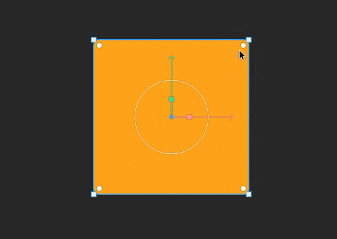
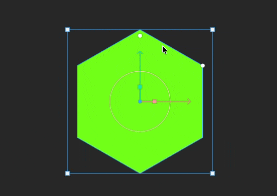
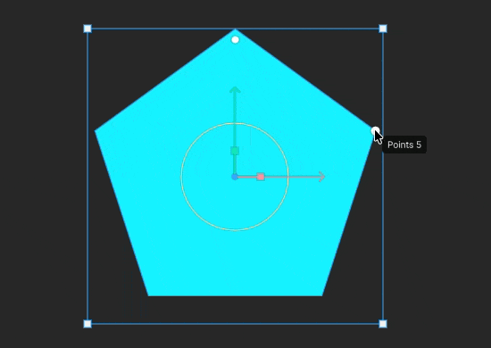
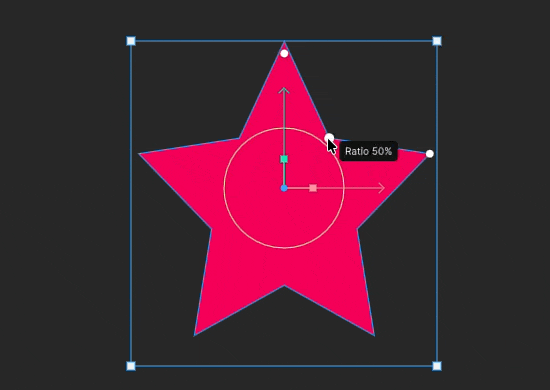

import { YouTube } from '/snippets/youtube.mdx'
import { VideoEmbed } from '/snippets/video-embed.jsx'

Shape tools let you create common shapes, such as rectangles, ellipses, triangles, polygons, and stars. These shapes keep editable properties, such as width, height, corner radius, and number of points, until you convert them to custom paths.

<YouTube id="vU5SrgymGD8" />

## Creating a shape

Shape tools are available from the **Create Tools** menu.

<Steps>
  <Step>
    Open the **Create Tools** menu and select a shape tool.
  </Step>
  <Step>
    Click and drag inside an artboard to draw the shape.

    Hold `Shift` while dragging to constrain the shape's proportions.
  </Step>
</Steps>

<VideoEmbed src="https://static.rive.app/video/create-rectangle.mp4" />

<Info>
  See [Origin](/editor/fundamentals/origin) to learn how to change the point a shape rotates and scales from.
</Info>

## Shape properties

You can update a shape's properties in its **Path** section of the inspector, such as **Rectangle Path** or **Star Path**. Available properties depend on the selected shape type.

- **Size**: The width and height of the shape.
- **Origin**: The [origin](/editor/fundamentals/origin) point of the shape.
- [Corner](#corner): The corner radius of rectangles.
- [Radius](#radius): The radius of polygons and stars.
- [Points](#points): The number of points on polygons and stars.
- [Inner radius](#inner-radius): How deep a star's inner points go, as a percentage of its size.

### Corner

Adjust the corner radius by dragging the circular handles on each corner of the rectangle.

Hold `Alt` (Windows) or `Option` (macOS) while dragging to adjust a single corner independently.

### Radius

Drag the radius handle to adjust the radius of all points on the shape at once.

### Points

Control the number of points by dragging the points handle up or down.

### Inner radius

Drag the handle on the star's inner point toward or away from the center to move the inner points. Moving them in makes the points sharper, and moving them out makes them blunter. Hold `Shift` to snap to 5% steps.

You can also type the inner radius in the second **Radius** field in the inspector.

## Converting a shape to a custom path

Press `Enter` to convert the selected shape to a path. After conversion, you can edit each vertex directly.

<VideoEmbed src="https://static.rive.app/video/convert-to-path.mp4" />

<Note>
  Converting a shape to a path removes its procedural properties, such as width, height, corner radius, and number of points. Any animations applied to those properties are also removed.
</Note>

<Info>
  To edit a path, see [Edit Vertices](/editor/fundamentals/edit-vertices).
</Info>
