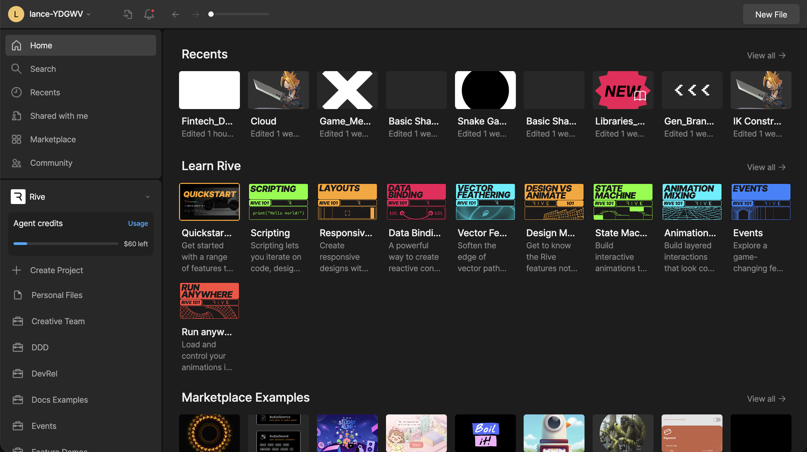
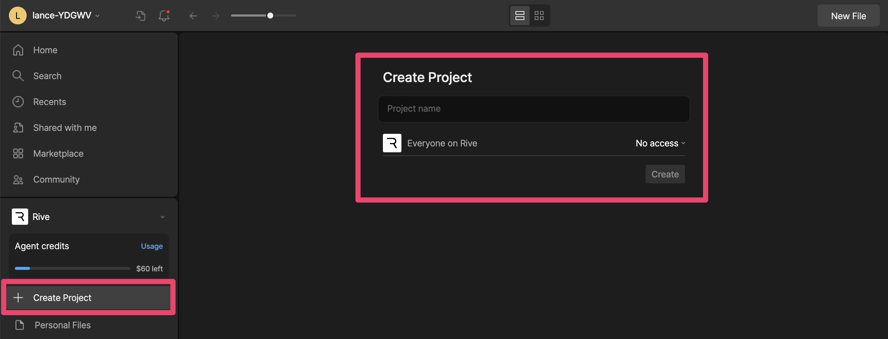
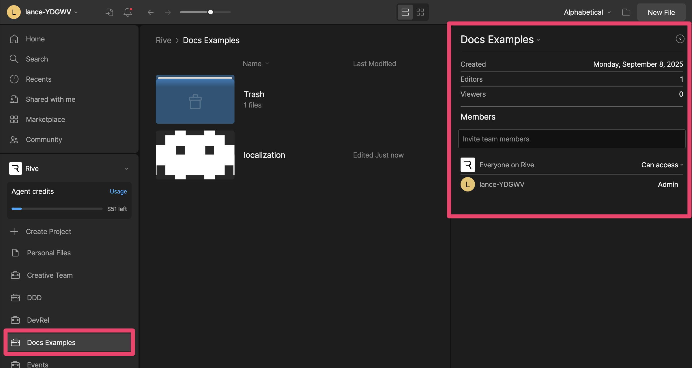

import { YouTube } from '/snippets/youtube.mdx'

The File Browser is where you create, open, organize, and manage your Rive files. You can also browse recent files, open Marketplace examples, switch between workspaces, and manage projects.

<YouTube id="m8WNIVeMOpk" />

## Home

The Home view shows your recent files, links to tutorial videos, and Marketplace examples.

- **Recents** - files you opened recently. **View all** opens the Recents page.
- **Learn Rive** - resources for learning Rive. **View all** opens the full playlist in your browser.
- **Marketplace Examples** - files from the [Rive Marketplace](/community/marketplace-overview) you can open and learn from. **View all** opens the Marketplace in your browser.
- **Announcement** - news from Rive, like new features and events. A dot on **Home** in the sidebar means there is a new announcement.

When you have a file open, click the **Home** tab in the tab bar to return to the File Browser.

## File tabs

Each file you open gets a tab in the tab bar at the top of the window.

- Click a tab to switch to that file. Press <kbd>Ctrl</kbd> + <kbd>Tab</kbd> or <kbd>Ctrl</kbd> + <kbd>Shift</kbd> + <kbd>Tab</kbd> to go to the next or previous tab.
- Double-click a tab's name to rename the file.
- Drag a tab to reorder it.
- Click the **X** on a tab to close the file.

When the tabs don't fit, a **+** button with a count appears at the end of the tab bar. Click it to see the other open files and pick one to switch to it.

### Tab menu

Right-click a file tab to close several tabs at once:

- **Close Other Tabs**: Close every tab except this one.
- **Close Tabs to the Right** and **Close Tabs to the Left**: Close every tab on that side of this one.
- **Close All Tabs**: Close every file tab.

[Viewport tabs](/editor/interface-overview/stage#viewport-tabs) have the same menu.

## Managing files

Right-click anywhere within the File Browser to create a new file or folder.

Right-click a file to open additional options, including:

- **Open**, **Copy**, **Cut**, **Duplicate**, and **Delete** - common file actions
- **Show File in Browser** - open the file’s location in the File Browser
- **Download** - download the file as a `.riv`
- **Download Backup** - download a `.rev` backup file
- **Download Revision** - download a specific revision
- **Add to Favorites** and **Remove from Favorites** - favorite files show a favorite icon and are listed under **Favorites** in the sidebar

The folder path above the files shows where you are. Click a folder in the path to jump back to it, or drop files on it to move them there.

## Toolbar

The toolbar includes options for managing your account, changing display options, creating folders, and creating new files.

- **Back** and **Forward** - step through the File Browser views you have visited.
- **Navigate to File** - paste a Rive file URL to jump to that file.
- **Notifications** - workspace invites, responses to your invites, and new followers. A red dot means you have unread notifications.
- **Account** - manage your account or sign out.
- **Thumbnail Size** - resize the thumbnails. List and grid views each keep their own size.
- **List** and **Grid** - show items as a list or as a grid of thumbnails. In list view, click a column header to sort by it, and click it again to flip the order.
- **Sort** - order items by last modified, created, or name, ascending or descending. **Group by type** puts folders first. **Group favorites** puts favorite files next.
- **New File Prompt** (sparkle) - when on, **New File** opens a prompt so the [AI Agent](/editor/ai-agent/ai-agent#starting-a-new-file-with-the-agent) can build the file for you. When off, **New File** makes a blank file.
- **New Folder** - create a folder in the current project.
- **New File** - create a Rive file in the current folder.

## Sidebar

Use the sidebar to search files, view recent files, access files shared with you, and navigate between workspaces and projects.

- **Home** - your recent files, tutorial videos, and Marketplace examples.
- **Search** - find files by name, including files shared with you.
- **Recents** - files you opened recently.
- **Favorites** - files you added to your favorites.
- **Shared with me** - files other people have shared with you directly. Each file shows the workspace it belongs to.
- **Tutorials** - video tutorials for learning Rive.
- **Marketplace** - browse files made by the community. Opens in your browser.
- **Community** - ask questions and share work on the [Rive community forum](https://community.rive.app/). Opens in your browser.

### Projects

Projects help you organize files within a workspace.

Use projects to group related files, such as files for a client, feature, campaign, or product area. For example, you might have separate projects for personal work and freelance work.

<Note>Projects and folders are available on Cadet, Voyager, and Enterprise plans. [Learn more about our plans and pricing](https://rive.app/pricing?utm_source=docs&utm_medium=content).</Note>

#### Create a new project

<Steps>
  <Step>
    In the sidebar, click **+ Create Project**.
  </Step>
  <Step>
    Add a project name and choose who should have access.
  </Step>
</Steps>

Use **Everyone in Workspace** to set access for all workspace members:

- **Can access** - each person keeps their workspace role.
- **Can view** - everyone is a viewer.
- **No access** - only members you add later.

#### Managing project members

You can invite people to a specific project. This is useful when someone needs access to a set of files, but does not need access to the entire workspace.

<Steps>
  <Step>
    In the sidebar, select a project.
  </Step>
  <Step>
    Expand the project details panel to invite, remove, or change permissions for individual members or groups.
  </Step>
</Steps>

The project details panel shows who can access the project:

- **Project name** - admins can click it to rename the project, set up library sharing, or archive the project.
- **Stats** - editor and viewer counts. These include external members who have access to files in this project.
- **Invite Team Members** - add people who are already in this workspace.
- **Everyone in Workspace** - set access for all workspace members: **Can access** (each person keeps their workspace role), **Can view** (everyone is a viewer), or **No access** (only listed members).
- **Members** - each person's project role: Editor, Admin, or Viewer. **Remove** takes them off the project.
- **External Members** - people outside this workspace who have access to individual files in this project. Admins can remove their access.

Click **Confirm changes** to apply your member changes. If they raise your bill, you'll see the cost and confirm before you're charged. Changes that lower your bill are credited to your account.

#### Archiving a project

Archived projects are hidden from the sidebar. To archive a project, click the project name in the project details panel and choose **Archive project**. To bring one back, open the [workspace admin](/account-admin/workspaces/workspaces-overview#workspace-admin), go to the **Projects** tab, and click **Restore**.

### Workspaces

Workspaces are separate spaces for files, members, and billing. You might have a personal workspace, a company workspace, or separate workspaces for different teams.

See [Workspaces Overview](/account-admin/workspaces/workspaces-overview) for more information.

<Note>
  If you only want to organize files or share a specific set of files, create a project instead of a new workspace.
</Note>