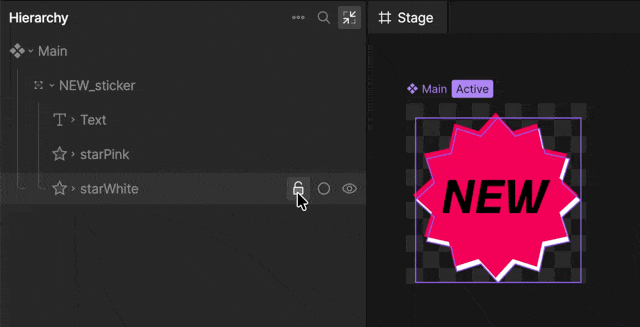
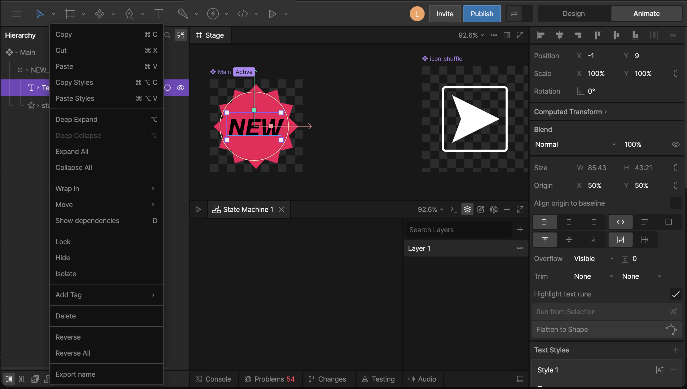

import { YouTube } from '/snippets/youtube.mdx'
import { VideoEmbed } from '/snippets/video-embed.jsx'

<YouTube id="FnnZV57Dp3c" />

The Hierarchy is a tree view that shows the objects on the stage. It shows both how objects are nested and the order in which they are rendered.

## Renaming items

You can rename items in the Hierarchy to make your file easier to understand and navigate.

To rename an item, double-click its name in the Hierarchy, enter a new name, then press Enter.

## Searching and filtering

Click the search button in the Hierarchy header to filter the Hierarchy by object name.

You can also filter the Hierarchy to one type of object, such as bones or layouts, with **Filter Trees** in the [View Options menu](/editor/interface-overview/stage#object-types). While a type filter is on, a **Filter** chip appears in the Hierarchy header. Click it to clear the filter.

## Parent-child relationships

Each row in the Hierarchy represents an item on the stage. Items with children have a button with an arrow next to them. Use this button to expand or collapse the list of children. Holding Alt/Option and clicking this arrow will deep expand the hierarchy item, revealing all children objects.

<VideoEmbed src="https://static.rive.app/video/hierarchy-expand.mp4" />

Any object can be a parent or child of another object. When an object is nested under another object, it inherits the transformations of its parent.

For example, scaling a parent object also scales its children. Parent transformations are applied from the parent’s origin, not the child’s local origin.

<VideoEmbed src="https://static.rive.app/video/hierarchy-transforms.mp4" />

<Note>
  To change where a parent rotates and scales from without moving its children, move its origin with [Freeze](/editor/fundamentals/origin#freeze).
</Note>

You can nest objects as deeply as needed, creating children, grandchildren, great-grandchildren, and so on. Nesting objects in [groups](/editor/fundamentals/groups#using-groups-as-pivots) lets you rotate and scale them around more than one point.

To change the relationship between objects, drag an item onto another item to make it a child. Drag it out of the parent to remove the relationship.

<VideoEmbed src="https://static.rive.app/video/grouping-items.mp4" />

## Draw Order

The Hierarchy also controls draw order. Objects higher in the Hierarchy render above objects lower in the Hierarchy.

<Note>
  You can override the default draw order with [custom draw order](/editor/animate-mode/animating-draw-order).
</Note>

To change draw order, drag objects up or down in the Hierarchy.

## Lock, isolate, and hide items

When you hover over an item in the Hierarchy, controls appear for locking, isolating, or hiding that item.

* **Lock** prevents the item from being selected or edited on the stage.
* **Isolate** focuses on the item by temporarily hiding other items from view.
* **Hide** hides the item. Hidden items don't render at runtime either.

These controls also apply to any children nested under the item.

To turn off isolation for every object on the active artboard, click the panel options button in the Hierarchy header and select **Clear Isolates**.

<Note>
  Lock and isolate are editor workflow tools. They do not change the exported file or runtime behavior.
</Note>

## Context menu

Right-click an item in the Hierarchy to open additional options. Depending on the selected item, options may include:

* Copy, cut, paste, delete, and [copy and paste styles](#copying-and-pasting-styles)
* Expand or collapse nested items
* Show dependencies
* Lock, hide, or isolate elements
* Add a [tag](/editor/tagging)
* Reverse the order of elements
* [Export name](/editor/exporting/exporting-names)

Many of these options are also covered in more detail on related pages.

## Copying and pasting styles

Use **Copy Styles** and **Paste Styles** to give shapes and text the same look.

<Steps>
  <Step title="Copy the styles">
    Right-click a shape or text object and select **Copy Styles**, or press `⌘` + `Alt` + `C` on macOS or `Ctrl` + `Alt` + `C` on Windows.
  </Step>
  <Step title="Paste the styles">
    Select one or more shapes or text objects, right-click, and select **Paste Styles**, or press `⌘` + `Alt` + `V` on macOS or `Ctrl` + `Alt` + `V` on Windows.
  </Step>
</Steps>

Styles are the object's [fills and strokes](/editor/fundamentals/fill-and-stroke), including their colors, gradients, and effects such as [trim paths](/editor/manipulating-shapes/trim-path), dashes, and [feathering](/editor/fundamentals/vector-feathering). Pasting replaces the existing fills and strokes on the selected objects. When you paste from one shape to another, the blend mode and opacity are copied too, and gradients are scaled to fit the new shape.

<Note>
  You can only copy and paste styles in Design mode, and you can copy from one object at a time.
</Note>

## Spaces

Spaces group your artboards in the editor. Each space has its own stage view and [background colors](/editor/interface-overview/stage#stage-background-colors). Use spaces to keep related artboards together.

Spaces only organize your work in the editor. They aren't exported.

### Showing spaces

Click the **Spaces** button in the Hierarchy header to switch the panel to **Spaces**. It lists each space with its artboards. Click the button again to return to the Hierarchy.

- Click a space to bring its stage forward in the viewport.
- Click an artboard to select it. Click the arrow next to it to show its objects in the Hierarchy.

### Creating and managing spaces

To add a space, click the **+** button in the panel header and select **Space**. The new space opens so you can name it. To add an artboard to a space, click the **+** button on the space's row.

- Drag an artboard onto another space to move it, or right-click it and select **Move to**.
- Drag spaces up or down to reorder them.
- Right-click a space to rename, duplicate, or delete it.

When you delete a space that has artboards, the editor asks what to do with them. A file always needs at least one space.

The panel options menu in **Spaces** has **Reset Project Layout**, which resets the sidebar layout.
