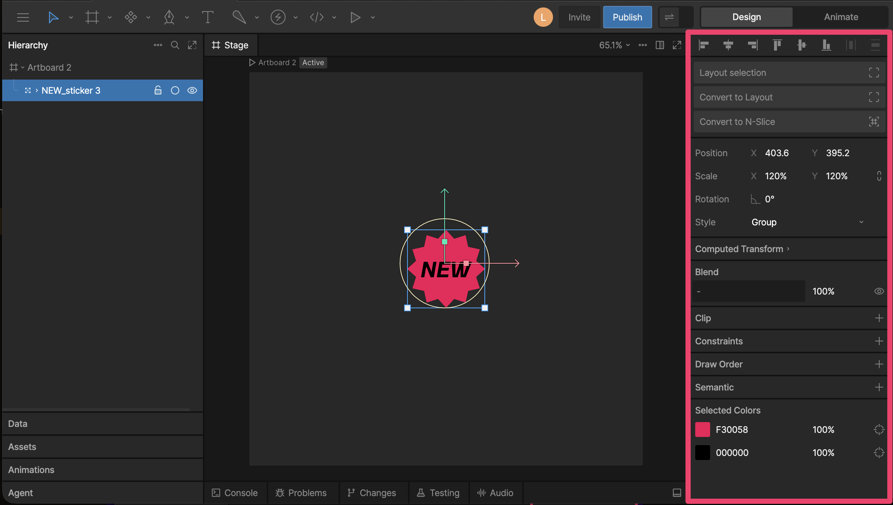

import { VideoEmbed } from '/snippets/video-embed.jsx'

The Inspector is the right sidebar in the editor. It shows the available properties and options for the current selection.

## Selection properties

When you select an element, the Inspector updates to show controls for that element.

For example, selecting an artboard, object, joystick, script, property group, or State Machine item shows different options based on what that element can do.

<VideoEmbed src="https://static.rive.app/video/inspector-context.mp4" />

## Transform properties

Most objects show a **Transform** section at the top of the Inspector.

- **Position:** the X and Y position, relative to the parent.
- **Scale:** the horizontal and vertical scale, around the object's [origin](/editor/fundamentals/origin). Click the link button to keep X and Y in proportion, so changing one changes the other by the same amount.
- **Rotation:** the rotation in degrees, around the origin.

Because these values are relative to the parent, moving, rotating, or scaling a parent also affects its children. Learn more in [Parent-child relationships](/editor/interface-overview/hierarchy#parent-child-relationships).

## Opacity and visibility

The **Blend** section holds the blend mode, opacity, and visibility of the selection.

- **Opacity** applies to the object and everything inside it.
- The **Visibility** button shows or hides the object and everything inside it. It's the same as **Hide** in the [Hierarchy](/editor/interface-overview/hierarchy#lock-isolate-and-hide-items). Hidden objects don't render at runtime either.

## Computed Transform

The **Computed Transform** section shows where an object ends up after layouts, constraints, and parents are applied. Click the section header to expand it. All values are read-only.

- **World:** the final X and Y relative to the root artboard. At runtime, this includes the offset of any artboards this one is nested in.
- **Artboard:** the final X and Y relative to the artboard the object is in.
- **Local:** the final X and Y relative to the parent, after layouts and constraints.
- **Size:** the final width and height after layout. Shown for layouts, text, and images.

These values can differ from the **Transform** values when a [layout](/editor/layouts/layouts-overview) or [constraint](/editor/constraints/constraints-overview) positions the object.

## Target For

When a single object is selected, the **Target For** section lists everything that targets it, such as [constraints](/editor/constraints/constraints-overview), [clipping](/editor/manipulating-shapes/clipping), masks, draw order rules, and State Machine listeners.

Click the target button on a row to jump to the object that uses it:

- **Select on Stage** selects the object that targets this one.
- **Open in State Machine** opens the State Machine at the listener that uses this object.

The section only appears when something targets the selection.

## File properties

When nothing is selected, the Inspector shows file-level options.

These include:

- [Stage background colors](/editor/interface-overview/stage#stage-background-colors) for Design and Animate modes
- Scripting optimization and debug settings
- [Shader targets](/scripting/wgsl-shaders#shader-targets)
- [Tags](/editor/tagging)
- [Default interpolation](/editor/animate-mode/interpolation-easing#default-interpolation)
