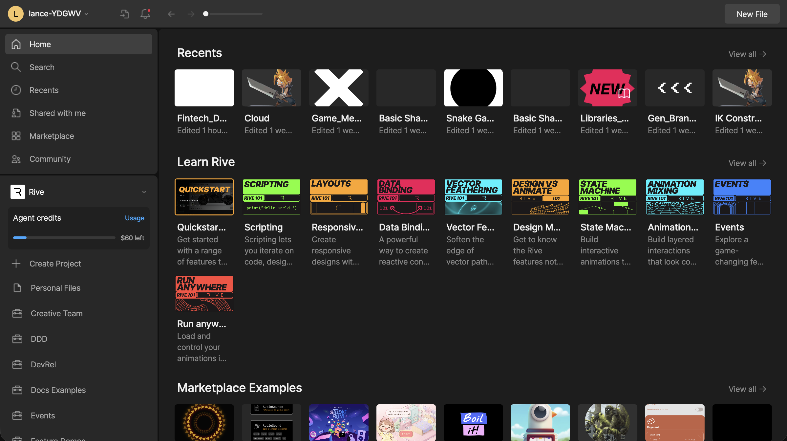
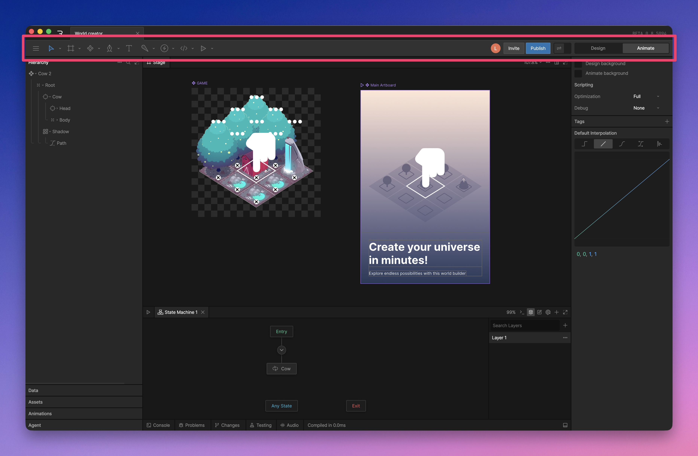
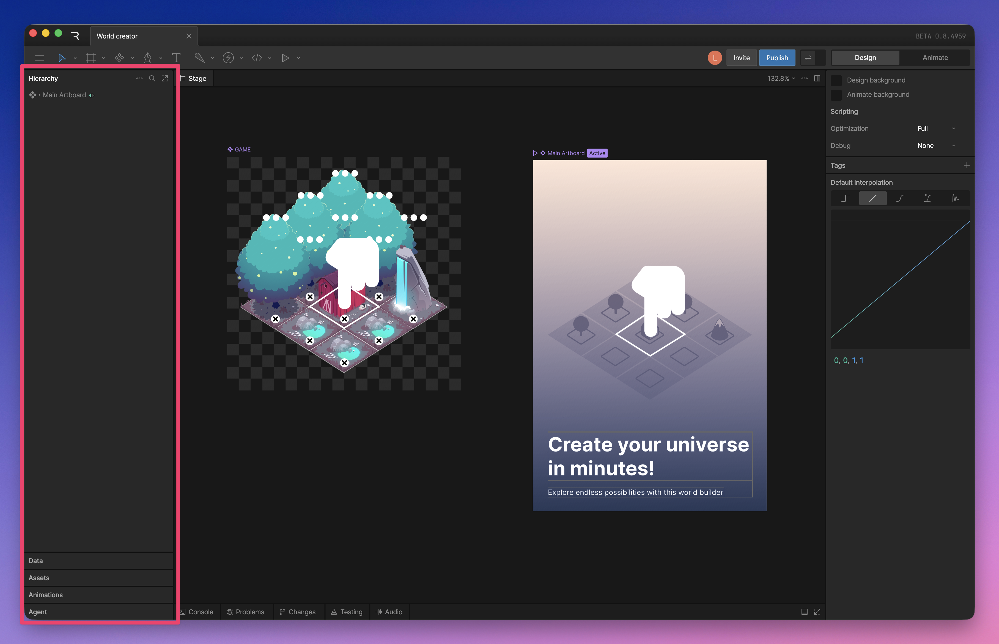
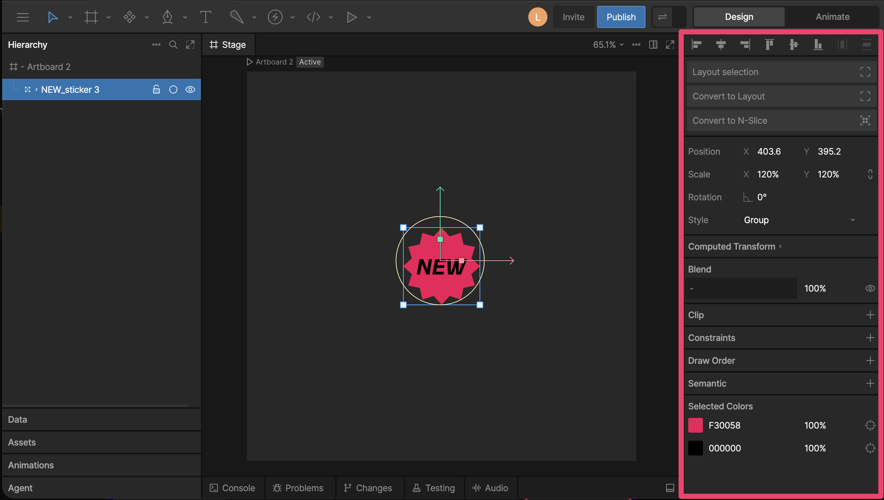
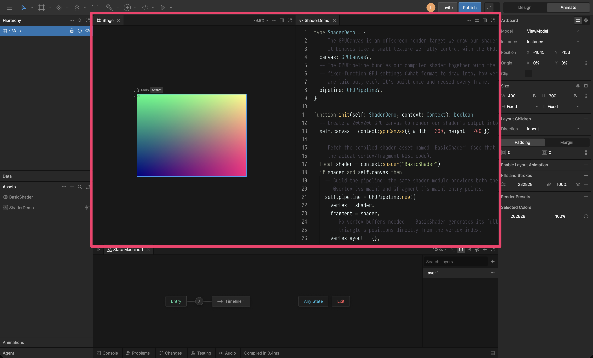
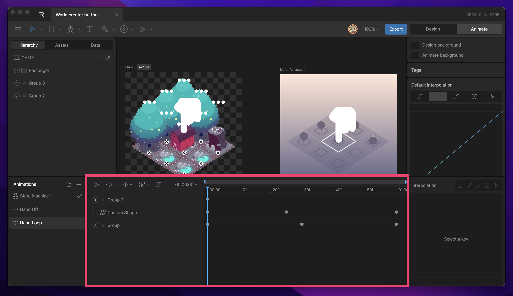
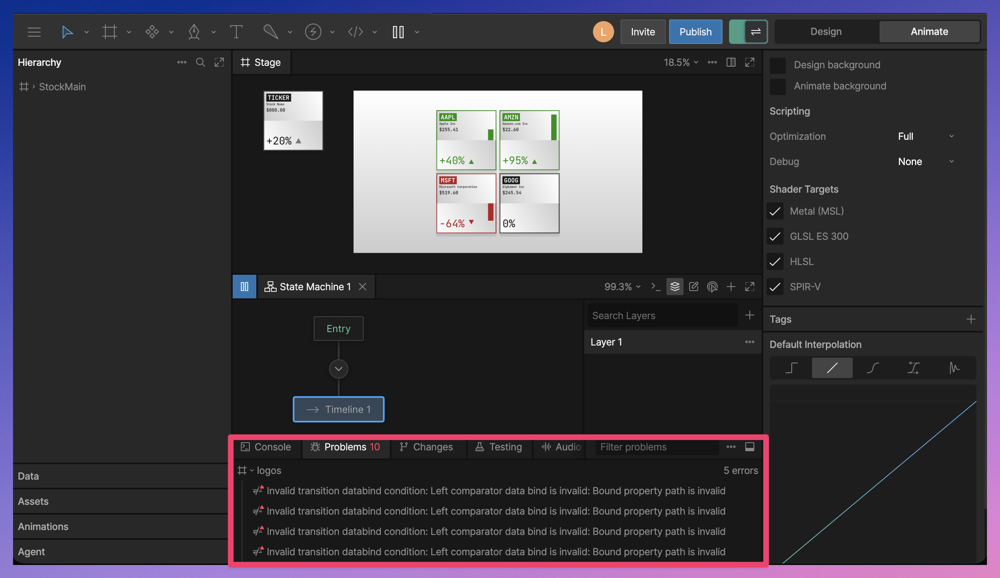

import { YouTube } from '/snippets/youtube.mdx'

<YouTube id="-NumdcojOTs" />

## File browser

The File Browser is where you create, open, organize, and manage your Rive files. You can also browse recent files, open Marketplace examples, switch between workspaces, and manage projects.

Read more on the [File Browser page](/editor/interface-overview/file-browser).

## Toolbar

The Toolbar displays the tools you have available to create, rig, and manipulate items on the stage. In addition to these tools, the Toolbar houses a variety of options to allow you to customize the look of your file, set your main artboard, and export or share your file.

Read more on the [Toolbar page](/editor/interface-overview/toolbar).

## Sidebar

The sidebar is the left side of the editor. It contains panels for navigating your file, managing assets, working with data, editing animations, and using the AI Agent.

Read more on the [Sidebar page](/editor/interface-overview/sidebar).

## Inspector

The Inspector is the right sidebar in the editor. It shows the available properties and options for the current selection.

Read more on the [Inspector page](/editor/interface-overview/inspector).

## Viewport

The Viewport is the central area between the Toolbar, Sidebar, and Inspector. It can display the Stage, scripts, and other panels.

The Stage is where you create and edit artboards, which contain the designs and animations in your Rive file.

Read more on the [Viewport page](/editor/interface-overview/stage).

## Timeline

The Timeline surfaces from the bottom of the screen upon entering [animate mode](/editor/fundamentals/design-vs-animate-mode). Here you can create new states, access playback controls, settings, and set keyframes for object parameters. Select a timeline from the left-hand list to switch between the respective timelines.

Read more on the [Timeline page](/editor/fundamentals/design-vs-animate-mode).

## State Machine graph

When a state machine is selected, the Timeline is replaced by a graph. This is where you'll be working on the state machine.

Read more on the [State Machine page](/editor/state-machine/state-machine).

## Debug Panel

The Debug Panel shows output and diagnostic information while you work. Use it to read console logs, find problems in your file, review AI Agent changes, run tests, and preview audio.

Read more on the [Debug Panel page](/editor/interface-overview/debug-panel).
