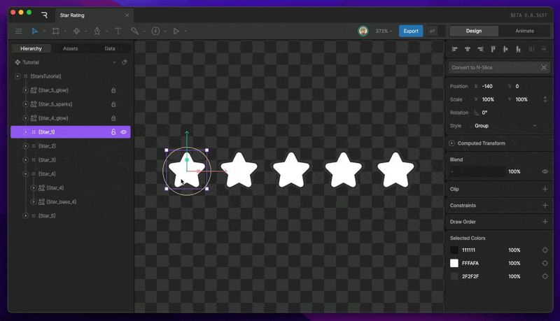
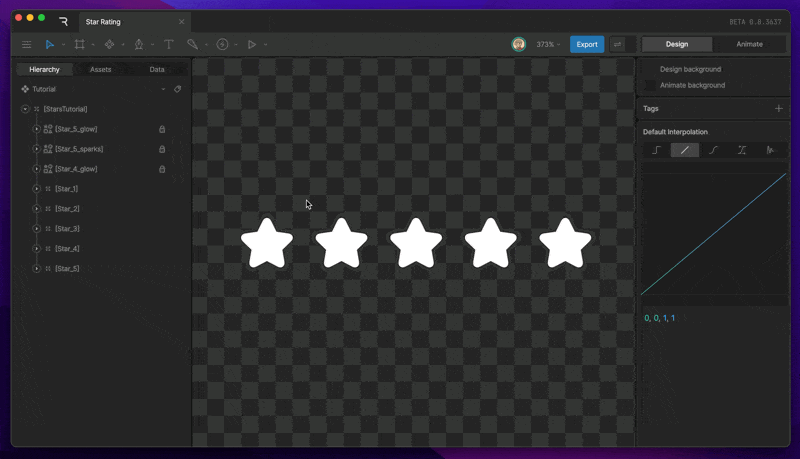
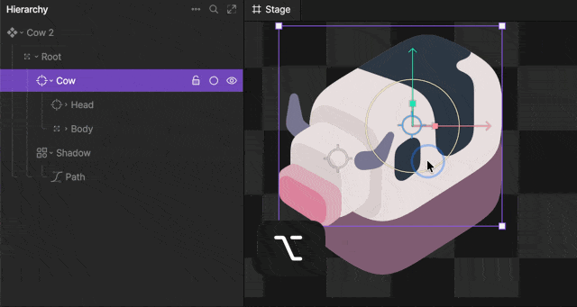
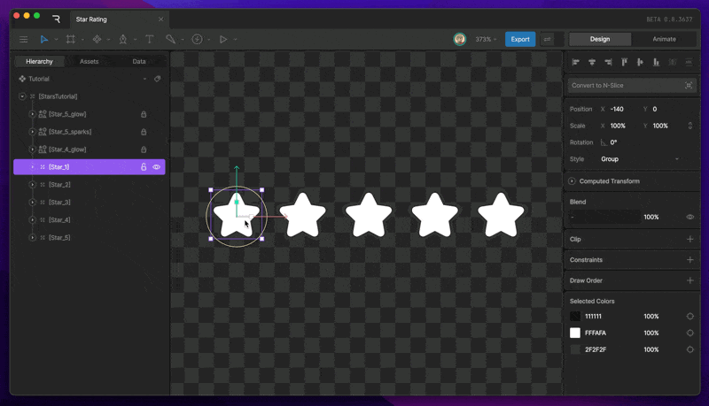
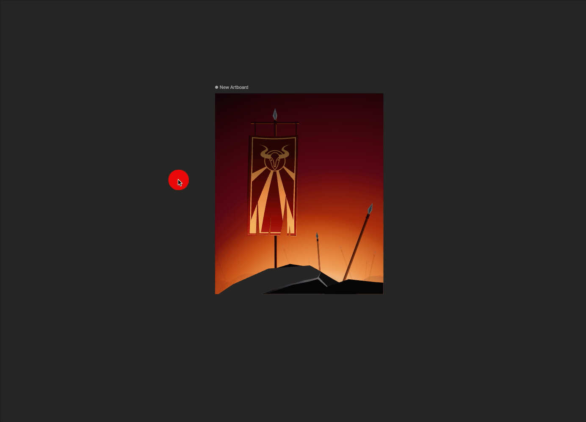
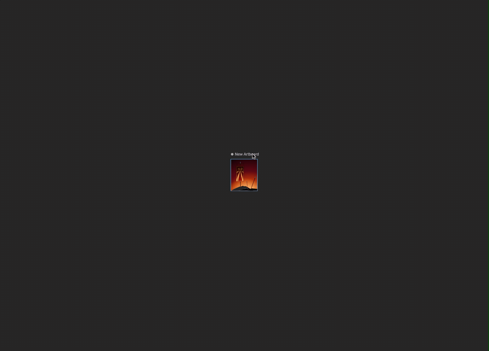

import { YouTube } from '/snippets/youtube.mdx'

Use selection and navigation controls to choose objects, move through nested groups, and move around the stage.

<Tip>
  For a complete list of shortcuts, see [Keyboard Shortcuts](/editor/keyboard-shortcuts).
</Tip>

## Selecting objects

<YouTube id="xQK498Y1J8M" />

Click an object to select it. To select multiple objects, drag over them to create a marquee selection.

Hold `Shift` while clicking or dragging to add objects to the current selection or remove selected objects.

### Select objects inside groups

To select an object inside a group, double-click the object. This moves you one level down in the hierarchy, so you can select objects inside that group.

### Deep select

To select an object inside nested groups, hold `⌘` on macOS or `Ctrl` on Windows, then click the object.

Deep select lets you select an object directly, even when it is inside multiple groups.

<Note>
  [Targets](/editor/fundamentals/groups#target-style) are directly selectable on the stage. You don't need to use **Deep Select** to select them.
</Note>

### Select behind

When you hover over an object on the stage, Rive outlines the object that will be selected if you click.

If multiple objects overlap, press `Alt` to cycle through objects under the cursor. When the object you want is outlined, click to select it.

You can also right-click and choose **Select** to pick from a list of the objects under the cursor. Hover a name to highlight that object on the stage.

### Moving up and down the Hierarchy

Use `Enter` and `Esc` to move through nested objects in the hierarchy.

* Press `Enter` to move down into the selected group and select its first child.
* Press `Esc` to move up and select the parent of the current selection.

## Transform handles

When you select an object, handles appear on the stage so you can move, rotate, scale, and resize it. Which handles appear depends on the [transform tool](/editor/interface-overview/toolbar#transform-tools) you're using.

### Gizmo

- **Red arrow:** drag to move the selection along its X axis only.
- **Green arrow:** drag to move the selection along its Y axis only.
- **Center dot:** drag to move the selection freely in any direction, like dragging the object itself.
- **Ring:** drag to rotate the selection around the gizmo's center. Hold `Shift` to snap to 45° steps.
- **Red square:** drag to scale the selection along its X axis. Hold `Shift` to scale proportionally.
- **Green square:** drag to scale the selection along its Y axis. Hold `Shift` to scale proportionally.

<Note>
  Artboards don't show a gizmo. Use the bounding box to move and resize them.
</Note>

### Bounding box

With the **Select** tool, a bounding box surrounds the selection.

- **Corners:** drag to resize from that corner. The opposite corner stays put. Hold `Shift` to keep proportions, or `Alt` to resize around the origin.
- **Edges:** drag to resize from that side. The opposite side stays put. Hold `Alt` to resize around the origin.
- **Outside a corner:** drag just outside a corner to rotate the selection. Hold `Shift` to snap to 45° steps.

## Navigating the Stage

### Pan

To pan the stage, right-click and drag.

You can also hold `Spacebar` to temporarily switch to the Pan tool, then click and drag to move around the stage.

If you're using a trackpad, scroll left or right to pan horizontally.

### Zoom

To zoom in or out, place your cursor over the stage, then hold `⌘` on macOS or `Ctrl` on Windows and scroll.

You can also use keyboard shortcuts:

* Press `+` to zoom in.
* Press `-` to zoom out.
* Press `⌘` + `0` on macOS or `Ctrl` + `0` on Windows to return to 100%.

### Fit selection

Press `F` to fit the current selection in the viewable stage area.

If an object is selected, Rive fits that object in view. If an artboard is selected, Rive fits the artboard in view.

<Tip>
  If you lose track of an artboard or object on the stage, select it in the hierarchy and press `F` to fit it in view.
</Tip>
