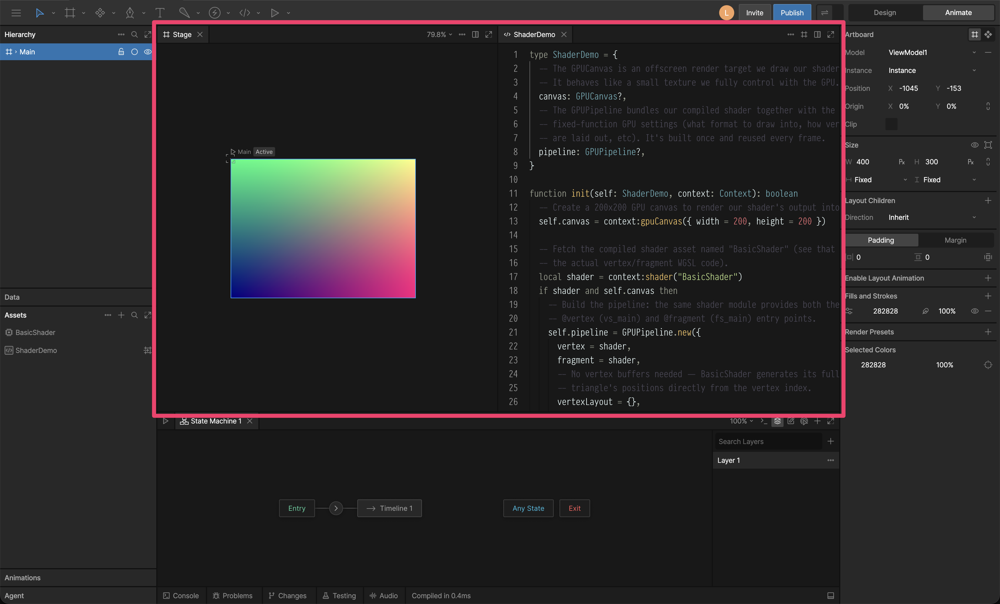
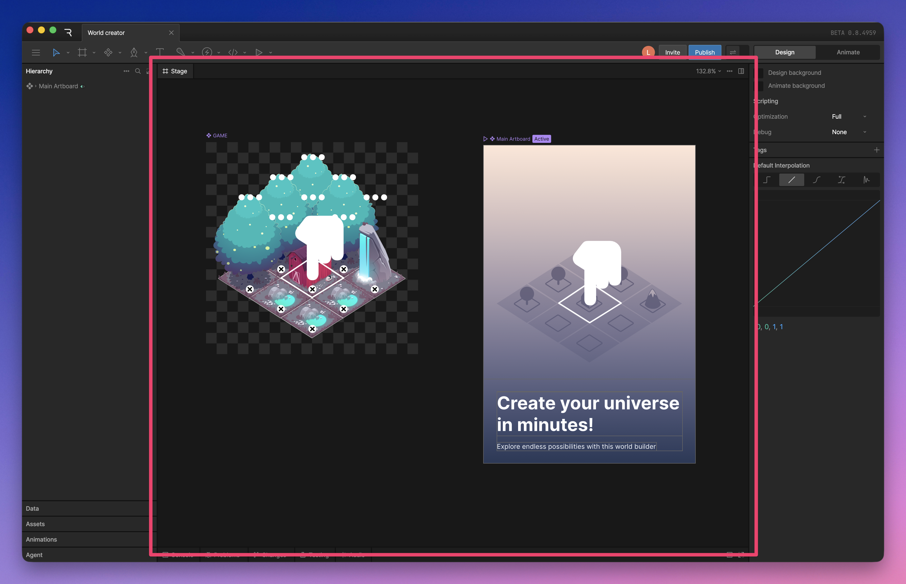
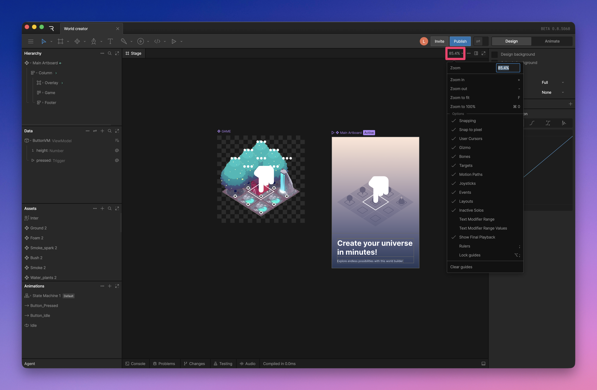

import { YouTube } from '/snippets/youtube.mdx'
import { VideoEmbed } from '/snippets/video-embed.jsx'

The viewport is the center area of the editor. It can show the [Stage](#stage), scripts, and the **AI Agent**.

You can [split the viewport](#splitting-the-viewport) to view multiple panels side by side or stacked vertically. This is useful when you want to edit artwork while viewing a script, or keep the AI Agent open alongside the Stage.

## Stage

The Stage is an infinite canvas where you can place artboards containing all your graphics.

[Artboards](/editor/fundamentals/artboards) live on the stage. You can pan and zoom around the stage, select objects, and use guides or rulers to help position elements.

<Tip>
  To learn how to navigate and select items on the stage, see [Keyboard Shortcuts](/editor/keyboard-shortcuts).
</Tip>

### View options menu

The View Options menu controls what appears on the stage while you work. Use it to adjust zoom, snapping, guides, and visual overlays for animation and interaction tools.

- **Zoom and snapping:** adjust the stage zoom level, enable snapping, or snap objects to pixels
- **User Cursors:** show or hide other users' cursors
- **Tool overlays:** show or hide gizmos, bones, targets, motion paths, joysticks, events, layouts, and text modifier ranges
- **Show Final Playback:** show the final playback state while editing
- **Rulers and guides:** show rulers, lock guides, or clear guides from the stage

#### Zoom and rotation

- **Rotation:** rotate your view of the stage. Your artwork isn't rotated. Click the lock icon in the field to stop trackpad twist gestures from rotating the view.
- **Zoom In** and **Zoom Out:** double or halve the zoom, around the center of the view.
- **Zoom to Fit:** zoom to fit the content in the view.
- **Zoom to 100%:** show the stage at actual size.
- **Reset Rotation:** turn the view back to no rotation.

#### Object types

The menu lists types of objects: **Bones**, **Targets**, **Stage Controls**, **Layouts**, and **Shapes & Images**. Each row has three buttons:

- **Select Only:** only this type of object can be selected on the stage.
- **Filter Trees:** show only this type of object in the [Hierarchy](/editor/interface-overview/hierarchy) and timeline.
- **Visibility:** show or hide this type of object in this view.

#### Other options

- **Inactive Solos:** show the children of [solos](/editor/manipulating-shapes/solos) that aren't active.

### Stage background colors

You can set separate stage background colors for Design mode and Animate mode.

Using different colors can make it easier to tell which mode you are in at a glance. This can help prevent accidentally editing keys or animation values when you meant to work in Design mode.

To change the stage background colors, deselect everything, then use the background color options in the [Inspector](/editor/interface-overview/inspector). Each [space](/editor/interface-overview/hierarchy#spaces) has its own background colors, and the Inspector edits the colors of the space you're viewing.

<VideoEmbed src="https://static.rive.app/video/stage-background-color.mp4" />

<Note>
  Stage background colors are only visible in the editor. They do not affect the artboard background, exports, or runtime appearance.
</Note>

## Splitting the Viewport

To split the viewport, drag a panel into the viewport or click **Split Editor Right** from the panel options.

<VideoEmbed src="https://static.rive.app/video/split-panes.mp4" />

To open the **AI Agent** in the viewport, click the **…** button in the **Agent** panel in the sidebar, then select **Open in Viewport**.

### Viewport tabs

Each split shows its content as tabs.

- Click a tab to show it.
- Drag a tab to reorder it, move it to another split, or drop it on an edge to split the view.
- Right-click a tab to close the other tabs, the tabs to its left or right, or all tabs.

A tab shown in italics is a preview tab. Opening something else replaces it. Click or drag the tab to keep it open.

Use the **Tab Options** button to close tabs, or to open a stage or a script in that split.

### Maximizing a split

Click the **Maximize Viewport** button in a split's tab bar to expand that split to fill the editor below the toolbar. Click **Restore Viewport** to return to your layout.

You can also press `` ` `` to maximize the split under your cursor, and press it again to restore.

### Document view

Text documents whose [Text File Format](/scripting/api-reference/file-format/text-file-format) script provides a preview show a **Document View** button in the tab bar. Click it to cycle between showing the text, the preview, or both side by side.

