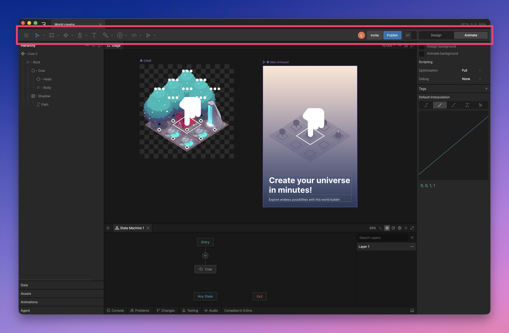
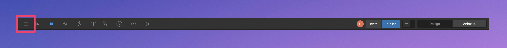
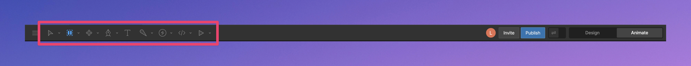
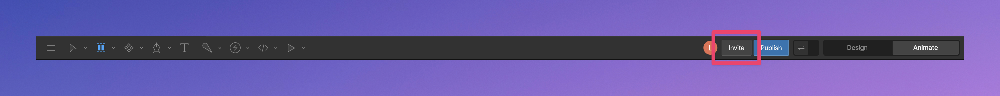
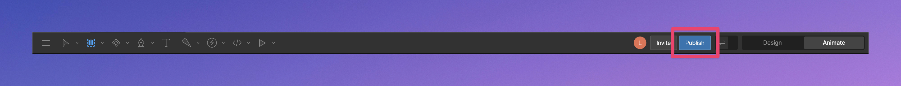
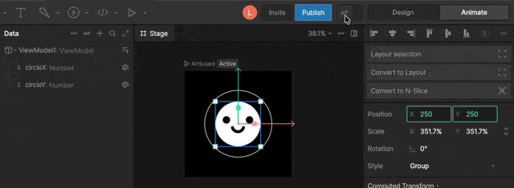
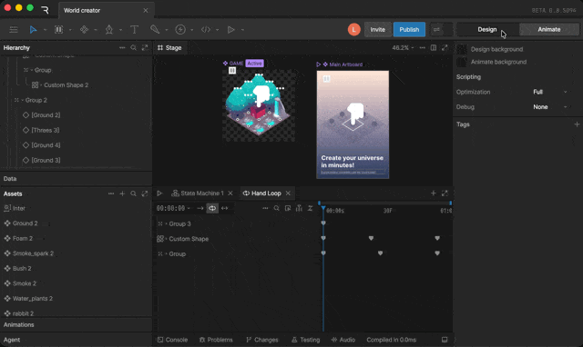

Use the toolbar to switch tools, create objects, adjust view options, invite collaborators, publish your file, and access file-level actions.

## Editor menu

The **Editor menu** contains file-level actions and editor settings.

Common actions include:

* [Revision History](/editor/fundamentals/revision-history)
* [Export for Runtime](/editor/exporting/exporting-for-runtime)
* [Export for Backup](/editor/exporting/exporting-for-backup)
* [Share and Embed](/editor/embed-urls/overview)
* [Render to Video or Image](/editor/exporting/exporting-for-video-and-static-design)

### Sharing

- **Share File**: Invite people to this file. See [Invite](#invite).
- **Copy File URL**: Copy a link that opens this file in the editor.

### Editor settings

These options are under **Options** in the menu.

- **Use Horizontal Field Drag**: Drag number fields left and right to change their value, instead of up and down.
- **Pause Component Updates**: Stop [components](/editor/fundamentals/components) on the stage from updating. Your changes to them show once you turn this off.

### Language

Use **Language** to change the language of the editor's interface. You can choose English, Español, or 简体中文. Languages marked **Beta** may have some text that isn't translated yet.

While you use a beta language, choose **Translation Feedback** to report problems or suggest fixes in the Rive Community.

You can also change the language from the account menu in the [File Browser](/editor/interface-overview/file-browser#toolbar).

### File maintenance

These items at the bottom of the menu update older files:

- **Convert Inputs to ViewModels**: Replaces state machine inputs with view model properties. See [Migrating State Machine Inputs](/editor/data-binding/migration-guide#state-machine-inputs).
- **Reset Layout Transforms**: Puts every [layout](/editor/layouts/layouts-overview) back where its parent layout places it, removing stray X and Y offsets. This item only appears until the file has been reset.

## Tools

The **Tools** area lets you select, transform, draw, create objects, add rigging, and preview interactions.

Common tools include:

* [Select, translate, rotate, and scale tools](#transform-tools)
* [Stage tools](#stage-tools), such as events and joysticks
* [Artboards](/editor/fundamentals/artboards) and [components](/editor/fundamentals/components)
* [Shape and drawing tools](/editor/fundamentals/shapes-and-paths-overview)
* [Bones tools](/editor/manipulating-shapes/manipulating-shapes)
* Play the [State Machine](/editor/state-machine/state-machine)

### Transform tools

Open the **Transform Tools** menu to pick how you move, rotate, and scale objects on the stage.

| Tool | Shortcut | What it does |
| --- | --- | --- |
| **Select** | `V` | Select objects and move, rotate, or scale them. Shows the full [gizmo](/editor/interface-overview/selection-and-navigation#gizmo) and the [bounding box](/editor/interface-overview/selection-and-navigation#bounding-box). |
| **Translate** | `Q` | Move objects precisely. Shows only the move handles. |
| **Rotate** | `W` | Rotate objects. Shows only the rotation ring. |
| **Scale** | `E` | Resize objects proportionately or non-proportionately. Shows only the scale handles. |

Tap `Q`, `W`, or `E` to switch to that tool. Hold the key instead to use the tool temporarily. When you let go, the editor switches back to the tool you were using.

The menu also has a [Freeze](/editor/fundamentals/origin#freeze) toggle (`Y`).

### Stage tools

The **Stage Control Tools** menu holds tools for objects that don't render. They control or organize other elements in your design or animation.

* [Event](/editor/events/overview)
* [Joystick](/editor/manipulating-shapes/joysticks)
* [Property Group](/editor/data-binding/property-groups)
* [Effect Group](/editor/manipulating-shapes/effect-groups)

## Invite

Use **Invite** to add collaborators to the file. You can also choose **Share File** in the [Editor menu](#editor-menu).

Only files in a shared project can be shared. To invite people to one of your personal files, move it to a shared project first.

## Publish

Use **Publish** to export, embed, or publish your file.

* [Export a .riv for runtime](/editor/exporting/exporting-for-runtime)
* Publish to a [library](/editor/libraries)
* [Embed](/editor/embed-urls/overview)
* Publish to the [marketplace](/community/marketplace-overview#marketplace-overview)

## Preview bound values

By default, data-bound values update while the state machine is playing.

Turn on the **Data Binding Preview Toggle** to preview bound values while editing.

## Mode toggle

Use the **Mode Toggle** to switch between **Design** and **Animate** mode. Press `Tab` to switch modes quickly.

- **Design Mode**: create, edit, import, and rig graphics.
- **Animate Mode**: create timelines, state machines, keys, and animation logic.

<Warning>
  Editing objects while a timeline is selected in Animate Mode can create keys. Learn more about [Design and Animate Modes](/editor/fundamentals/design-vs-animate-mode).
</Warning>

