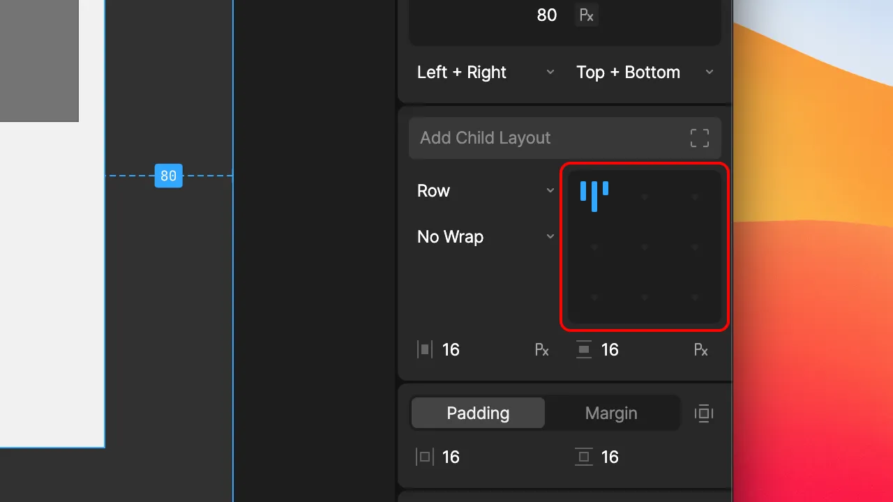
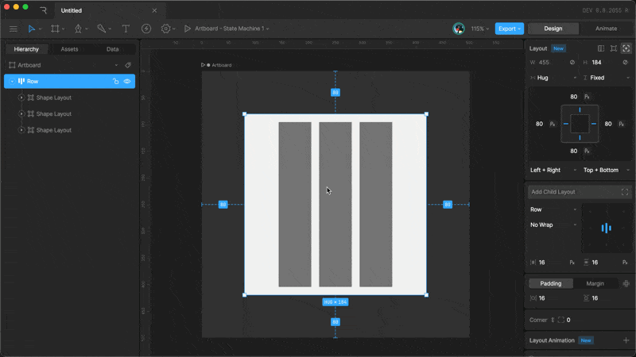
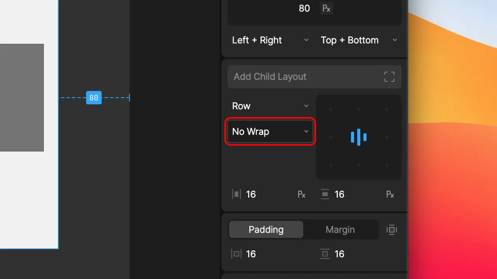
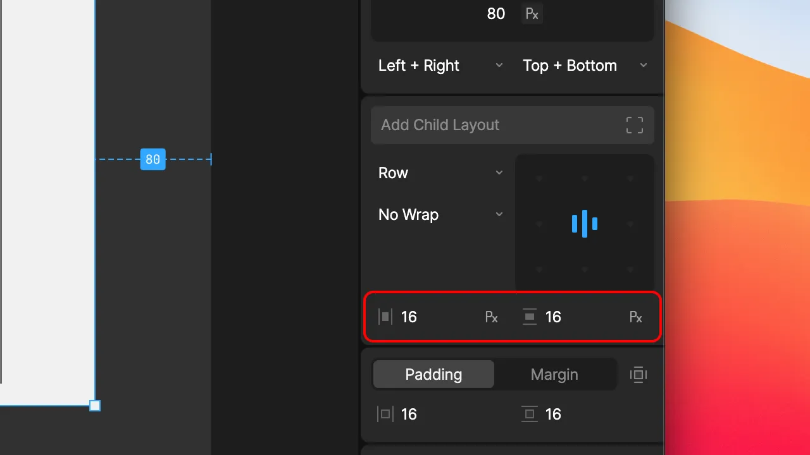

import { YouTube } from '/snippets/youtube.mdx'
import { UseCase } from '/snippets/use-case.mdx'

A Layout arranges the children that participate in it. This page covers the settings you set on the parent: which direction its children flow, how they wrap and align, and how much space surrounds and separates them.

These settings only affect children that participate in the Layout: other Layouts, shapes, text, and images set to **Layout** in the **Inspector**, and component instances in **Layout** mode. Absolute children ignore them. To control a child's own size or pin it to the parent's edges, see [Sizing and Positioning](/editor/layouts/sizing-and-positioning).

## Layout type

The layout type decides the overall pattern a Layout uses to arrange its children:

- **Row:** Places children side by side, from left to right.
- **Column:** Places children one below another, from top to bottom.
- **Grid:** Places children in cells defined by columns and rows. See [Grid](/editor/layouts/layout-parameters#grid).
- **Stack:** Places all children in the same space, layered on top of each other. See [Stack](/editor/layouts/layout-parameters#stack).

Children are arranged in hierarchy order. To change the order, reorder the children in the **Hierarchy** or drag them on the stage.

To flip the order of a Row or Column without reordering the hierarchy, select the **Reverse** checkbox. A reversed Row runs from right to left, and a reversed Column runs from bottom to top.

The direction a Layout arranges its children in is its **main axis**. A Row's main axis is horizontal, and a Column's is vertical. The other direction is the **cross axis**. Several settings, including alignment, wrap, and [Fill](/editor/layouts/sizing-and-positioning#fill), behave differently along each axis.

## Alignment

Alignment decides where children sit within the Layout when they don't take up all of its space. Select one of the nine points on the alignment widget in the **Inspector**, such as top-left or center.

Alignment moves children as a group. In a Row aligned to the center, the children stay next to each other and the group sits in the middle of the Row.

### Space between

To spread children out along the main axis instead, click the selected point again. The first child moves to the start of the Layout, the last child moves to the end, and the remaining space is shared evenly between them. The cross-axis alignment stays the same. Click the point again to group the children back together.

<UseCase title="A navigation bar">
  A navigation bar is a Row containing a logo, a set of links, and a profile button. With space between, the logo sits at the left edge, the profile button at the right edge, and the links in the middle. When the bar gets wider, the space between them grows while each item stays the same size.
</UseCase>

## Wrap

Wrap decides what happens when a Row or Column runs out of room for its children:

- **No Wrap:** Children stay on a single line and extend past the Layout's edge.
- **Wrap:** Children that don't fit move onto a new line below a Row, or a new column beside a Column.
- **Wrap Reverse:** Same as **Wrap**, but new lines are added in the opposite direction, above a Row or before a Column.

Use Wrap for content that should reflow onto more lines as the space gets narrower, such as a set of tags or a gallery of thumbnails.

## Padding, gap, and margin

Rive has three settings that add space in a Layout. Padding and gap are set on the parent, and margin is set on the child.

- **Padding:** Space between the parent's edges and its children. Padding is set on the parent and pushes all of its children inward.
- **Gap:** Space between neighboring children. Gap is set on the parent and applies evenly between every pair of children.
- **Margin:** Space around one child. Margin is set on the child and only affects that child. See [Margin](/editor/layouts/sizing-and-positioning#margin).

<UseCase title="Spacing out a list">
  A Column contains three list items. To keep the items 24 points from the Column's edges, add 24 points of padding to the Column. To put 12 points between each item, set the Column's vertical gap to 12. To give one item extra space above it, such as the start of a new section, add a top margin to that item only.
</UseCase>

<Tip>
  Prefer gap over margins for even spacing. If every child has a 10-point margin, neighboring children end up 20 points apart, because their margins add together. A 10-point gap puts exactly 10 points between each child and nothing at the edges.
</Tip>

Padding only affects children that participate in the Layout. To add space around a label inside a button, the label needs to participate in the button's Layout. You can either set the label to **Layout** in the **Inspector**, or wrap it in its own Layout.

### Setting padding

Padding can be set the same on both sides of an axis, or separately on each edge. Use the edge toggle to show a field for each edge, and use the unit toggle to switch between points and percentages.

<video width="640" controls>
  <source src="https://ucarecdn.com/a489bd85-d55b-424b-8f7a-1a1a7aab37f6/" type="video/mp4"></source>
  Padding and Margin
</video>

### Setting gap

Gap can be set separately for the horizontal and vertical directions, in points or as a percentage of the Layout's width or height. In a Row that wraps, the horizontal gap separates children on the same line, and the vertical gap separates the lines.

## Text direction

Text direction decides whether a Layout reads left to right or right to left. Use it to support right-to-left languages such as Arabic and Hebrew.

- **Inherit:** Use the parent Layout's direction. This is the default.
- **Left to Right:** Rows run from left to right, and text aligns to the left.
- **Right to Left:** Rows run from right to left, and text aligns to the right.

The direction passes down to every child Layout set to **Inherit**, so you can usually set it once on the artboard or an outer Layout.

<YouTube id="oLjFOu-UFxM" />
