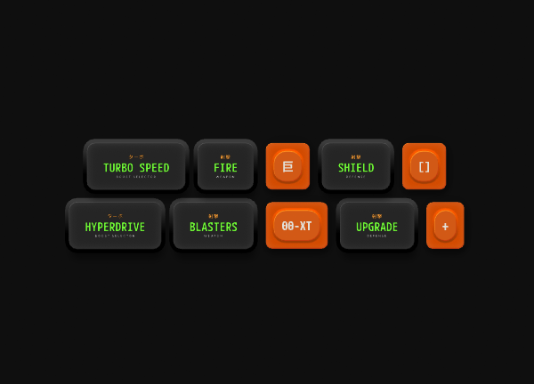

import { VideoEmbed } from '/snippets/video-embed.jsx'
import { Marketplace } from '/snippets/marketplace.mdx'
import { UseCase } from '/snippets/use-case.mdx'

When a Layout resizes or its content changes, the Layouts inside it move to new positions and sizes. By default, they jump there instantly. Layout animation makes them move there smoothly instead, over a duration and with easing that you choose.

<Marketplace
  href="https://rive.app/community/files/28493-enable-layout-animation"
/>

## How Layout animation works

Layout animation is set on each Layout, and it controls how **that Layout** moves and resizes. It doesn't control the Layout's children. Each Layout uses one of three modes:

- **None:** The Layout jumps to its new position and size. This is the default.
- **Inherit:** The Layout animates using the duration and easing of its parent Layout.
- **Custom:** The Layout animates using its own duration and easing.

To animate a group of children, such as the items in a list, set the parent to **Custom** and each child to **Inherit**. You can then change the duration and easing for all of them in one place on the parent.

<UseCase title="Reordering a list">
  A Column contains five list items. The Column's Layout animation is set to **Custom** with a 0.3-second duration and cubic easing, and each list item is set to **Inherit**. When an item is removed, the items below it slide up to fill the gap instead of jumping.
</UseCase>

## Adding Layout animation

<Steps>
  <Step>
    Select a Layout and click **+** in the **Enable Layout Animation** section of the **Inspector**.
  </Step>
  <Step>
    Select **None**, **Inherit**, or **Custom**.
  </Step>
  <Step>
    If you selected **Custom**, set the **Duration** and the [interpolation](/editor/animate-mode/interpolation-easing) the Layout uses to move to its new position and size.
  </Step>
</Steps>

<VideoEmbed src="https://static.rive.app/video/enable-layout-animation.mp4" />
