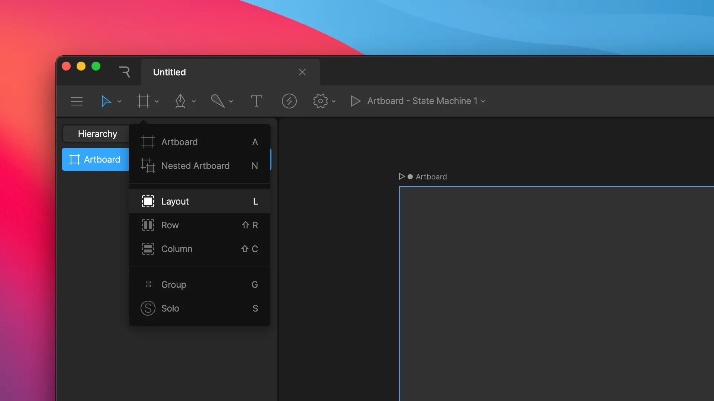
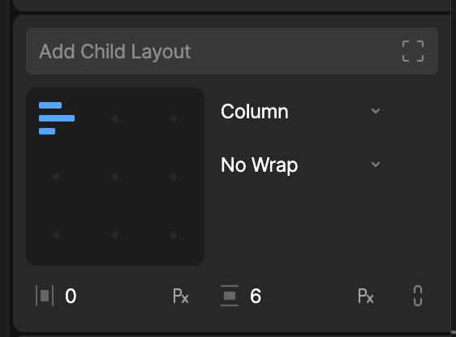
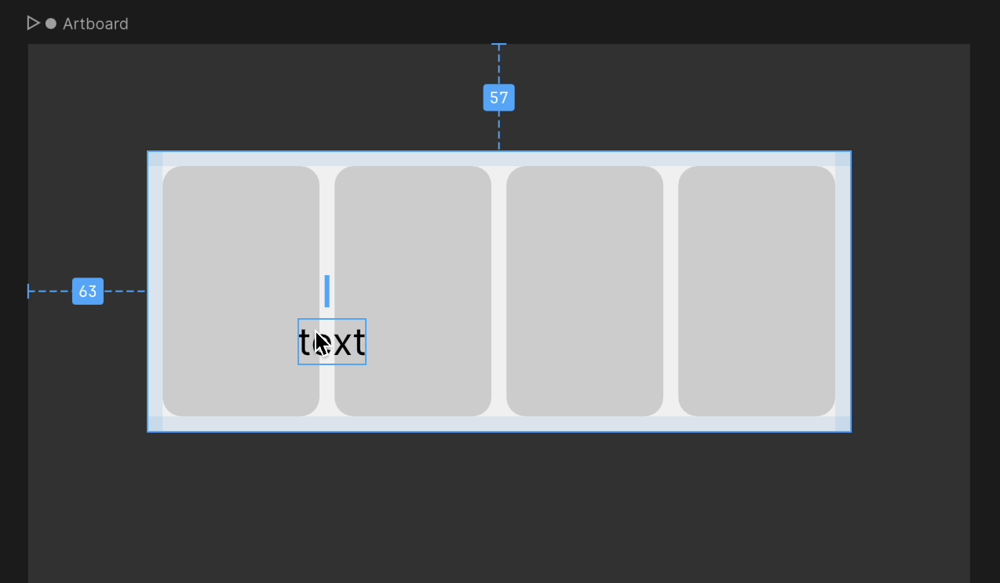

import { VideoEmbed } from '/snippets/video-embed.jsx'

You can start a responsive design from empty Layouts, or add Layouts to artwork you've already made. This page covers each way to create a Layout and how to move Layouts in and out of each other.

## Drawing a Layout

The Layout tools are in the **Arrangement Tools** menu in the toolbar.

To draw a single, empty Layout, select the **Layout** tool (<kbd>L</kbd>) and drag on the stage.

- Drag on the artboard to create an [absolute](/editor/layouts/sizing-and-positioning#relative-and-absolute-positioning) Layout that's positioned freely.
- Drag on top of an existing Layout to create a relative child of that Layout.

Any objects inside the area you drag are wrapped in their own Layouts and placed inside the new Layout as absolute children.

<VideoEmbed src="https://ucarecdn.com/994d9855-4783-478f-a808-e5f8e57511af/" />

### Drawing a Row, Column, Grid, or Stack

The **Row**, **Column**, **Grid**, and **Stack** tools draw a Layout of that [type](/editor/layouts/arranging-children#layout-type) that already contains children, so you can start arranging content right away.

- **Row** (<kbd>Shift</kbd>+<kbd>R</kbd>) and **Column** (<kbd>Shift</kbd>+<kbd>C</kbd>): While dragging, press <kbd>↑</kbd> or <kbd>↓</kbd>, or a number key, to set the number of children. The children's widths and heights are set to **Fill**.
- **Grid:** Draws a Grid with two `1fr` columns and two `1fr` rows. While dragging, press <kbd>↑</kbd> or <kbd>↓</kbd> to add or remove a column and row together, or a number key to set the number of each.
- **Stack:** Draws a Stack containing layered children of decreasing size.

<VideoEmbed src="https://ucarecdn.com/e6fb26b0-a322-4715-8764-f484b99fd70a/" />

## Wrapping content in a Layout

To add a Layout around content you've already made, select one or more objects and do one of the following:

- Right-click the selection on the stage or in the **Hierarchy**, then select **Wrap in** > **Layout**.

  <VideoEmbed src="https://ucarecdn.com/8dc09645-bb6b-4572-a519-5f655d39e114/" />

- Press <kbd>Shift</kbd>+<kbd>L</kbd>.

  <VideoEmbed src="https://ucarecdn.com/fc768d5a-33bf-4ce5-88fe-c40257263bc2/" />

- Click **Layout Selection** in the **Inspector**. This button appears when the selection doesn't include any Layouts.

  <VideoEmbed src="https://ucarecdn.com/cca29ef7-5762-40a7-bfb2-0b1ac9da5ee8/" />

<Tip>
  Shapes, text, and images don't always need a wrapper Layout. To make one participate in its parent Layout directly, select it and choose **Layout** instead of **Node** at the top of the **Inspector**. See [What takes part in a Layout](/editor/layouts/layouts-overview#what-takes-part-in-a-layout).
</Tip>

## Adding a child Layout

To add an empty Layout inside the selected Layout, click **Add Child Layout** in the **Inspector**. The new child's width and height are set to **Fill**.

## Moving Layouts into other Layouts

You can move any Layout into another Layout at any time:

- **In the Hierarchy:** Drag the Layout onto its new parent.
- **On the stage:** Drag the Layout over its new parent. An indicator shows where among the parent's children it will be inserted.

When you drag any object over a Layout on the stage, it becomes a child of that Layout when you drop it. To move an object over a Layout without putting it inside, hold <kbd>Cmd</kbd> (macOS) or <kbd>Ctrl</kbd> (Windows) while dragging.

To remove a Layout, select it on the stage or in the **Hierarchy** and press <kbd>Delete</kbd>.
