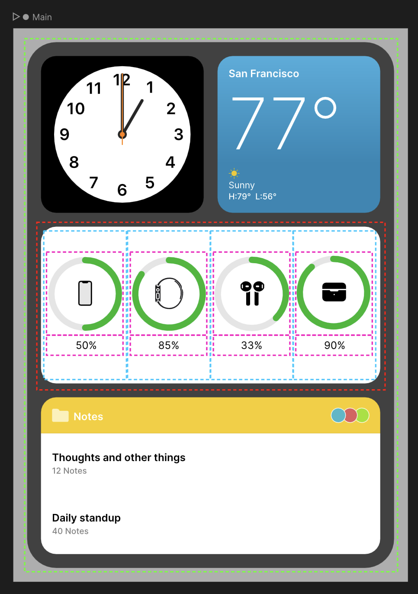
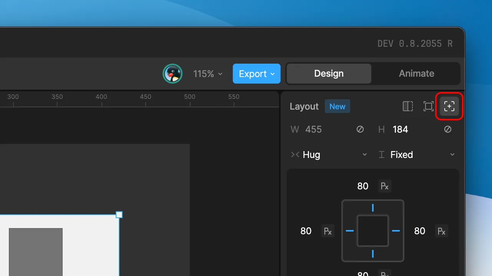
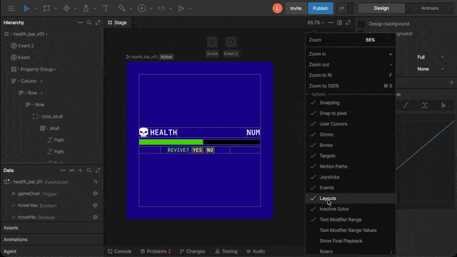

import { YouTube } from '/snippets/youtube.mdx'
import { Marketplace } from '/snippets/marketplace.mdx'
import { UseCase } from '/snippets/use-case.mdx'

A responsive graphic adapts when the space it lives in changes size. A button grows to fit a longer label, a menu reflows from one column to two on a wider screen, and a card stays pinned to the corner of a resizing window.

In Rive, that space is the artboard. In the editor, you change it by resizing the artboard. In your app or game, the artboard takes the size of the view or canvas it's drawn into. Layouts let you define how your content responds when that size changes.

<YouTube id="jANBKRidBtk" />

## Freeform and Layout content

By default, Rive content is freeform. Each object has a position, rotation, and scale, and stays exactly where you put it. When the artboard changes size, freeform content doesn't move.

A **Layout** is a container that positions and sizes its content using rules instead of fixed coordinates. Rive's Layouts work much like Flexbox and CSS Grid on the web: a Layout can arrange its children in a row, a column, a grid, or a stack, with padding, gaps, and alignment.

You don't have to choose between freeform and Layout content. You decide which objects follow Layout rules, and you can mix both in the same artboard, or even inside the same Layout.

## How Layouts work

Responsive design in Rive comes down to a few ideas. Once these click, the rest of the Layout settings are details.

### The artboard is the root Layout

The artboard itself is a Layout. It has its own Layout settings in the **Inspector**, and the Layouts you add inside it respond to its size. When the artboard resizes, that change flows down through every Layout inside it.

### Layouts nest inside other Layouts

Most responsive designs are built from Layouts inside other Layouts. The outer Layout is the **parent**, and the Layouts inside it are its **children**. Each level handles one part of the design, such as a page made of rows, rows made of cards, and cards made of an image and a label.

In the example above, the outer Layout (green) arranges its children in a column. One of those children (red) is a row of four battery indicators (blue), each set to take an equal share of the row's width. Each indicator is itself a column containing a battery graphic and a label (pink). When the outer Layout resizes, every level adjusts.

<Marketplace href="https://rive.app/community/files/26209-layouts-example/" />

### Parents arrange, children size themselves

Layout settings split into two groups, and knowing which group a setting belongs to makes Layouts much easier to work with:

- **The parent arranges its children.** Direction (row, column, grid, or stack), wrapping, alignment, padding, and gap are set on the parent and control where its children go.
- **Each child sets its own size.** Width, height, and margin are set on the child.

Each child's width and height uses one of three scale types:

- **Fixed:** A set size, in points or as a percentage of the parent.
- **Hug:** Shrinks to fit the child's own content, such as a label that's as wide as its text.
- **Fill:** Expands to take up the available space in the parent. When several children use Fill, they share the space.

If a setting doesn't seem to do anything, check whether you've set it on the right object. For example, to add space around a button's label, add padding to the button, not to the label.

<UseCase title="A button that fits its label">
  A button is a Layout set to **Row** with **Hug** width and height, and with padding on each side. Inside it is a text object set to participate in the Layout. Because the button hugs its content, changing the label from "OK" to "Continue" makes the button wider, while the padding stays the same.
</UseCase>

### Absolute and relative positioning

A Layout child is positioned in one of two ways:

- **Relative:** The parent decides where the child goes, based on its direction, alignment, and gap. Relative children reflow when the parent changes size or when other children are added or removed.
- **Absolute:** The child ignores the parent's arrangement and pins itself to the parent's edges instead, such as 16 points from the top and right. Absolute children don't affect the position of their siblings.

Use the toggle at the top-right of the Layout section in the **Inspector** to switch between absolute and relative.

## What takes part in a Layout

A Layout arranges only the children that participate in it. Other content inside a Layout moves with the Layout but isn't arranged in its rows, columns, or grid.

| Content | How it behaves inside a Layout |
| --- | --- |
| Layouts | Always participate. |
| Shapes, text, and images | Participate when you select **Layout** instead of **Node** at the top of the **Inspector**. A shape, text, or image switched to Layout starts with **Hug** width and height. |
| Component instances | Participate when their mode is **Layout**. In **Leaf** mode, they're scaled to fit the parent Layout. See [Component Sizing](/editor/layouts/component-sizing). |
| Groups | Don't participate themselves, but the content inside them can. |
| Everything else, such as paths, bones, and joysticks | Moves with the Layout, but isn't arranged by it. |

Text, images, and parametric shapes (rectangles, ellipses, triangles, polygons, and stars) that sit directly inside a Layout without participating are resized to fill that Layout. This is why many designs wrap each piece of content in its own Layout: the outer Layout arranges the wrappers, and each wrapper sizes its content.

For artwork that needs to resize without distorting, such as a custom-drawn button background, see [N-Slicing](/editor/layouts/n-slicing).

## Breaking out of a Layout

Objects inside a Layout can still use Rive's freeform tools. You can move, scale, and rotate an object away from where the Layout put it, and you can apply [constraints](/editor/constraints/constraints-overview) to it. This is useful for animation. For example, a list item can sit in its Layout position until it's selected, then animate out to the center of the screen.

<YouTube id="mAd2z5b4eNY" />

## Previewing responsive behavior

To see how your design responds, resize the artboard on the stage and watch your Layouts adjust. Try very narrow and very wide sizes to find where the design breaks.

<Tip>
  If Layouts aren't visible on the stage, open the **View Options** menu and make sure **Layouts** is enabled.

  
</Tip>

## Responsive graphics at runtime

At runtime, the artboard is drawn into a container that's sized by your app or game. To make the artboard take the size of that container, set the runtime's fit mode to **Layout**.

<Warning>
  The default fit mode, **Contain**, scales the whole artboard as a single image. Your Layouts won't respond to the container until you change the fit mode to **Layout**.
</Warning>

See [Artboard size at runtime](/editor/fundamentals/artboards#artboard-size-at-runtime) for how each fit mode behaves, and [Runtime layout](/runtimes/layout) for how to set it on each platform.

## Learning more

- [Tools](/editor/layouts/layout-tools): Create Layouts and wrap existing content in them.
- [Parameters](/editor/layouts/layout-parameters): Every Layout setting, including scale types, padding, Grid, and Stack.
- [Component Sizing](/editor/layouts/component-sizing): Control how component instances respond to their parent Layout.
- [Layout Animation](/editor/layouts/layout-animation): Animate children as they move to new positions.
- [N-Slicing](/editor/layouts/n-slicing): Resize artwork without distorting its corners and edges.
- [Scroll Constraint](/editor/constraints/scroll-constraint): Make the content of a Layout scrollable.

### Tutorials

Build a responsive button from scratch:

<YouTube id="dx63jfWJtLQ" />

Build a file that repositions its elements when resized:

<YouTube id="_dE4ndRZB6U" />

<Note>See the [Layouts playlist](https://www.youtube.com/playlist?list=PLujDTZWVDSsGvor80PkjHaZ3hNNo6s_ef) on Rive's YouTube channel for more Layout tutorials.</Note>
