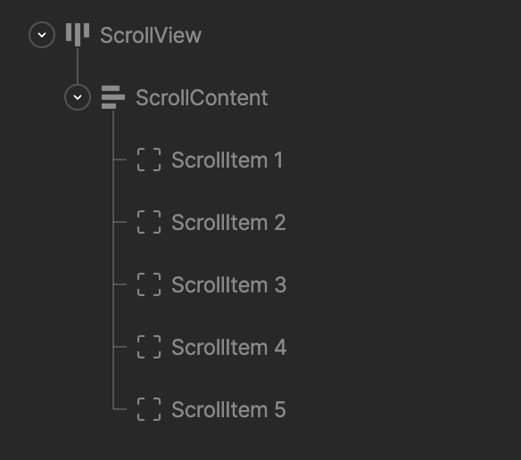

As a responsive design gets smaller, its content eventually stops fitting. A Layout has three ways to handle content that's larger than the space available:

- **Reflow:** Use [Wrap](/editor/layouts/arranging-children#wrap) to move content onto more rows or columns.
- **Shrink:** Use [Fill](/editor/layouts/sizing-and-positioning#fill) and [size constraints](/editor/layouts/sizing-and-positioning#size-constraints) so content gets smaller, down to a minimum size.
- **Scroll:** Keep the content at its full size and let people scroll to see the rest.

Scrolling is the right choice when the amount of content can grow without a limit, such as a list of messages, a feed, or a menu with many options.

## How scrolling works in Rive

Scrolling in Rive is a [constraint](/editor/constraints/constraints-overview) that you add to a Layout. A scroll region is made of three levels of Layouts:

- **Scroll view:** The Layout that defines the visible area. Its size usually comes from the rest of your responsive design, such as a Fill height in a Column.
- **Scroll content:** A Layout inside the scroll view that holds everything that scrolls. This Layout gets the **Scroll** constraint. Set it to **Hug** so it grows with its content.
- **Scroll items:** The Layouts inside the scroll content, such as the rows of a list.

When the scroll content is larger than the scroll view, people can scroll it by dragging, with a mouse wheel or trackpad, or you can drive it from an animation or [Data Binding](/editor/data-binding/overview).

## Setting up scrolling

For step-by-step setup and every scroll setting, see [Scroll Constraint](/editor/constraints/scroll-constraint). That page also covers:

- [Scrolling a list](/editor/constraints/scroll-constraint#scrolling-a-list) built with [Data Binding lists](/editor/data-binding/lists).
- [Adding a scroll bar](/editor/constraints/scroll-constraint#adding-a-scroll-bar) that people can drag.
- [Snapping](/editor/constraints/scroll-constraint#snap) to items as scrolling stops.
