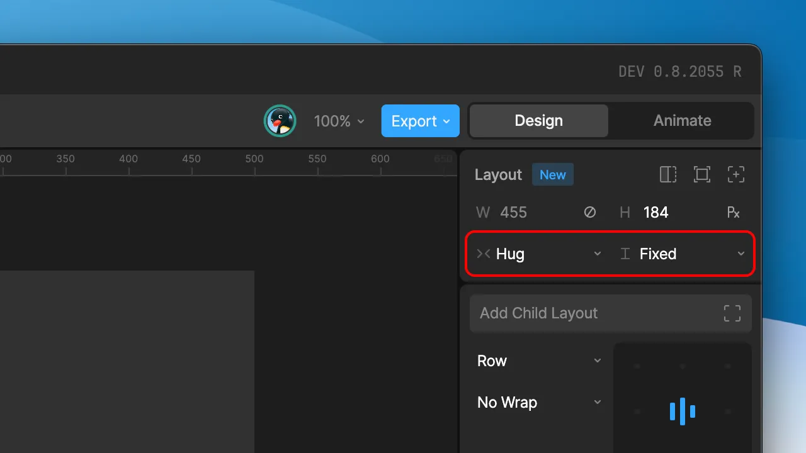
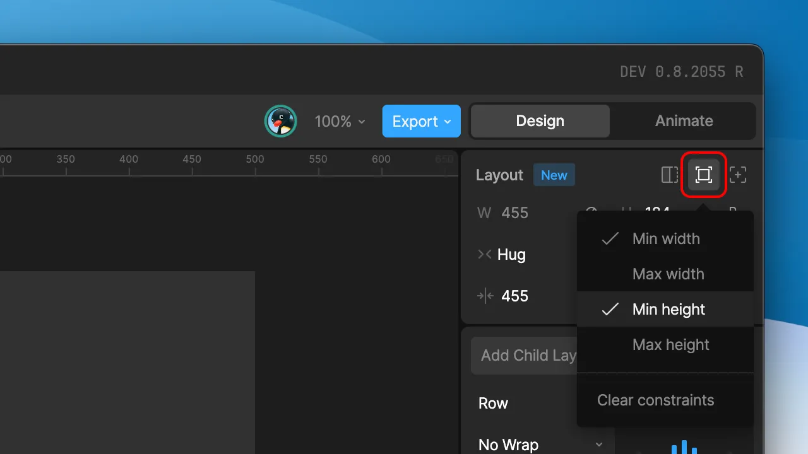
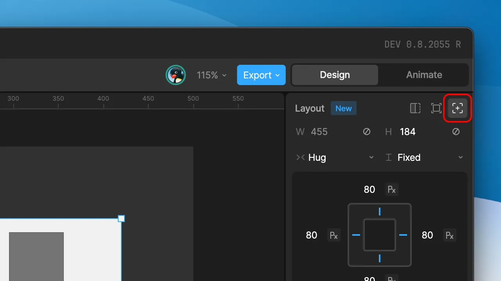
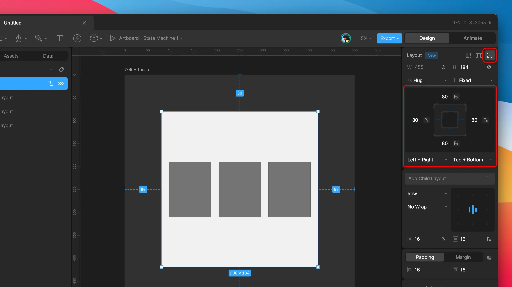

import { YouTube } from '/snippets/youtube.mdx'
import { UseCase } from '/snippets/use-case.mdx'

In a Layout, the parent decides how its children are arranged, and each child decides its own size. This page covers the settings you set on a child: its width and height, size limits, margin, and whether it's positioned relative to its siblings or pinned to its parent's edges.

These settings apply to anything that participates in a Layout: other Layouts, and shapes, text, and images set to **Layout** in the **Inspector**. Component instances in **Layout** mode use the same width and height options. See [Component Sizing](/editor/layouts/component-sizing).

For settings that control how a parent arranges its children, such as direction, padding, and gap, see [Arranging Children](/editor/layouts/arranging-children).

## Width and height

A child's width and height each use one of three scale types: **Fixed**, **Hug**, or **Fill**. You can set width and height independently. For example, a button can hug its label horizontally while keeping a fixed height.

Select the scale type below the width and height fields in the **Inspector**.

<YouTube id="eOGfPV7zBbQ" />

### Fixed

A Fixed width or height stays the same size regardless of the parent or the child's content. Enter a value in points, or use the unit toggle in the field to switch to a percentage of the parent's size.

Percentages are useful when a child should scale with its parent but you don't want it to take up all the available space, such as a panel that's always 50% of the screen width.

### Hug

A Hug width or height shrinks or grows to fit the child's own content. Use Hug when the content should determine the size, such as a button that grows with its label or a list that gets taller as items are added.

To Hug, a Layout needs content it can measure: child Layouts, text, or parametric shapes (rectangles, ellipses, triangles, polygons, and stars). If the Layout has nothing it can measure, the Hug option isn't available.

A Layout that hugs child Layouts always grows to fit them. Text and other content that Rive measures works differently: by default, a Hug child sized by that content stops growing at the edge of its parent, even if the content is larger. To let it grow to its full content size, select **Hug past bounds**. For example, a long block of text in a [scroll region](/editor/layouts/scrolling) needs this option so it can grow taller than the visible area. This option appears when the width or height uses Hug. Min and max [size constraints](#size-constraints) still apply.

This tutorial uses Hug to build a button that resizes with its label:

<YouTube id="dx63jfWJtLQ" />

<Note>
  An artboard can only Hug if it contains a relative Layout or a component instance in **Layout** mode.
</Note>

### Fill

A Fill width or height expands to take up the space available in the parent. Fill is only available on relative children inside a Layout. Absolute children can't use Fill.

How Fill behaves depends on whether the axis runs in the same direction as the parent's arrangement:

- **Along the parent's direction:** In a Row parent, this is width. In a Column parent, it's height. The child shares the leftover space with its siblings that also use Fill. The amount is measured in `fr` (fill ratio) units.
- **Across the parent's direction:** In a Row parent, this is height. In a Column parent, it's width. The child stretches to the parent's full size, minus padding.

Fill ratios decide how siblings split the leftover space. Three children set to `1fr` each get an equal share. A child set to `2fr` gets twice the space of a child set to `1fr`.

<UseCase title="A sidebar and content area">
  A Row Layout contains a sidebar and a content area, both set to Fill width. The sidebar is `1fr` and the content area is `3fr`, so the sidebar takes a quarter of the width and the content area takes the rest. When the Row gets wider, both grow, and the sidebar stays a quarter of the width.
</UseCase>

When a child uses Fill along its parent's direction, the **Inspector** also shows a **Base size** field. The base size is the child's starting size before the leftover space is shared out. Set it in points or as a percentage, or leave it on auto to start from the size of the child's content.

## Size constraints

Size constraints set a minimum or maximum width or height. They're most useful with Hug and Fill, when you want a child to respond to its content or parent but only up to a point. For example, a text field can fill its row but stop growing at 400 points wide.

Click the icon above the absolute/relative toggle, then select **Min width**, **Max width**, **Min height**, or **Max height**. Like width and height, constraints can be set in points or percentages.

## Margin

Margin adds space outside a child, between it and its parent's edges or its siblings. Use the edge toggle to set margin on each side separately, and use the unit toggle to switch between points and percentages.

Margin is set on the child, unlike padding and gap, which are set on the parent. To add the same space between all of a parent's children, use the parent's gap instead of giving each child a margin. Margins on neighboring siblings add together, so two children with a 10-point margin are 20 points apart. See [Padding, gap, and margin](/editor/layouts/arranging-children#padding-gap-and-margin).

## Relative and absolute positioning

A child is positioned in one of two ways:

- **Relative:** The parent places the child based on its direction, alignment, and gap. Relative children reflow when the parent resizes or when siblings are added or removed.
- **Absolute:** The child ignores the parent's arrangement and pins itself to the parent's edges. Absolute children don't take up space, so their siblings are arranged as if they weren't there.

Use absolute positioning for things that should stay in place while other content reflows, such as a close button in the corner of a dialog or a badge on a card.

Use the toggle at the top-right of the Layout section in the **Inspector** to switch between relative and absolute.

### Pinning to edges

An absolute child is pinned to at least two edges of its parent: one horizontal and one vertical. The distance from each pinned edge stays the same when the parent resizes.

To choose which edges to pin, select the markers in the position widget in the **Inspector**, or use the fields below it. Hold <kbd>Shift</kbd> while selecting a marker to pin a second edge on the same axis, such as both left and right. Distances can be set in points or as a percentage of the parent's size.

<UseCase title="A badge on a card">
  A notification badge is an absolute child of a card, pinned 8 points from the top and 8 points from the right. When the card's content changes size, the badge stays in the top-right corner, and the card's other content is arranged as if the badge weren't there.
</UseCase>
