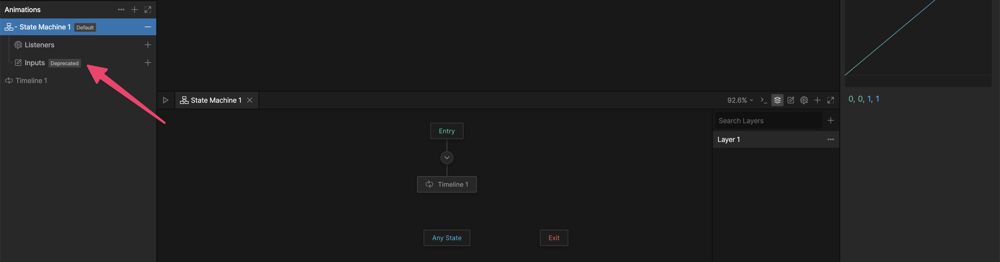
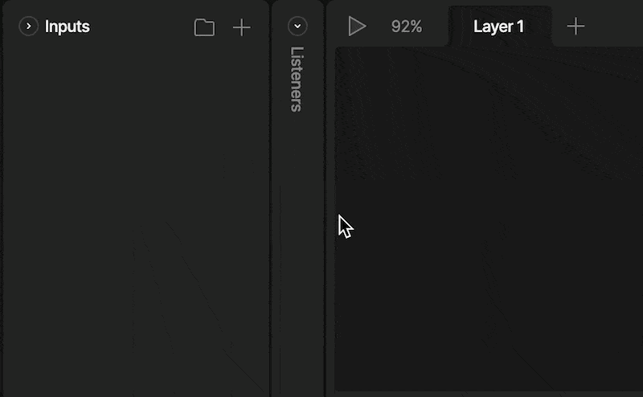
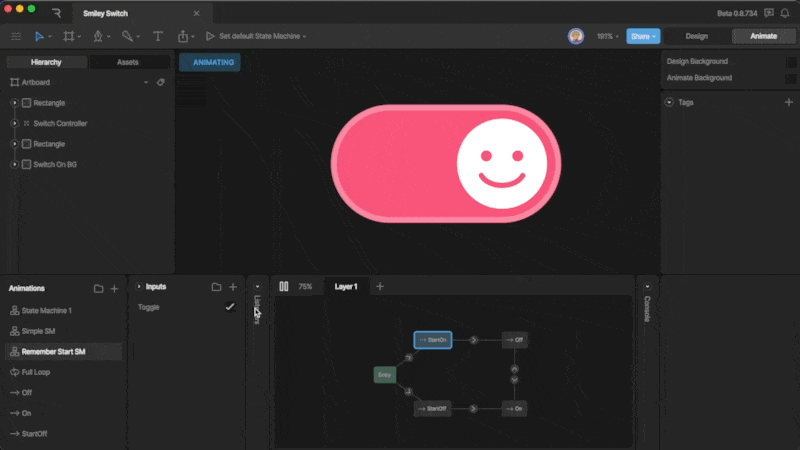
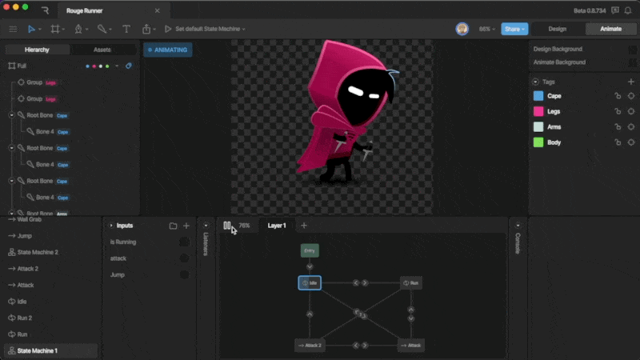
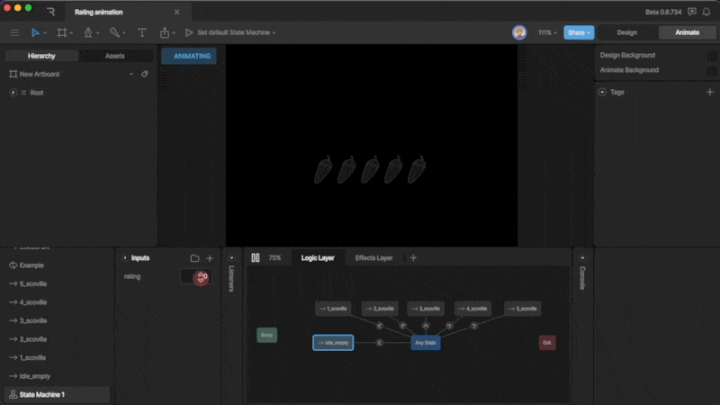
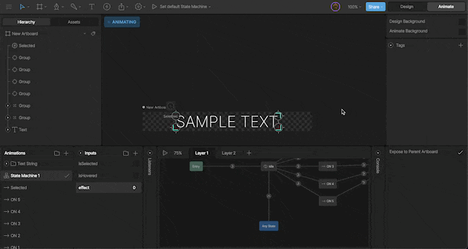
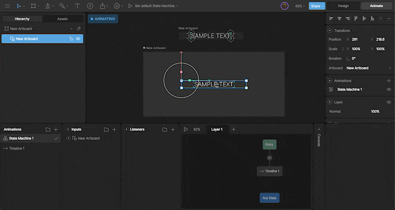
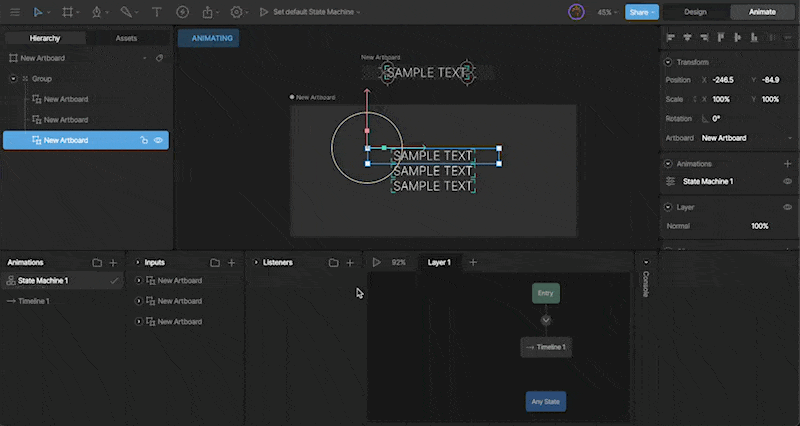
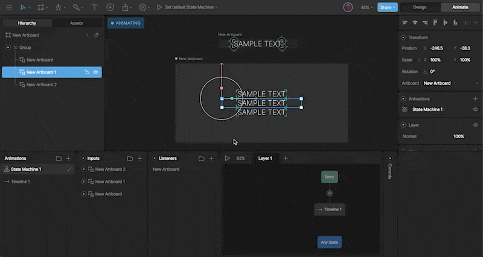

import { YouTube } from "/snippets/youtube.mdx";

<Warning>
  **DEPRECATION NOTICE:** This entire page documents the legacy Inputs system.
  **For new projects:** Use [Data Binding](/editor/data-binding/migration-guide) instead. **For
  existing projects:** Plan to migrate from Inputs to Data Binding as soon as
  possible. **This content is provided for legacy support only.**
</Warning>

<Note>
  **Inputs have moved**

  **Inputs** now live in the **Animations** panel. Expand the relevant state machine to view its **Listeners** and **Inputs** sections.

  
</Note>

Inputs are a legacy tool to control transitions in our state machine. While Inputs can still be used to control transitions, Data Binding is considered best practice since View Models are both more powerful and easier to control at runtime.

The best use for Inputs is quick, prototype interactions that you don't plan to migrate to runtime.

<YouTube id="rJVfBs6VA0I" />

### Creating a new input

To create a new Input, use the plus button in the input panel. After hitting the plus button, you’ll be prompted to select the type of input you want to create. There are three types of inputs; booleans, triggers, and numbers.

## Input types

We can use three types of inputs depending on the situation and type of interactive content: booleans, triggers, and numbers. We'll discuss each of these inputs below.

### Boolean

A boolean can hold either a true or false value.

### Trigger

Triggers are similar to booleans, but can only become true for a short time.

### Number

A number input give you a number box that can be any integer.

## Exposing inputs and events

Expose the Inputs and/or Events of a Component to control them from a parent/host Artboard. This allows you to control one Component with another via a State Machine.

### How to expose an input

Exposing an Input allows the parent artboard to access and manipulate it. To do this, select the desired input, then check the expose to main artboard option in the inspector.

After creating a Component, you’ll see any exposed inputs in the Inspector via the options panel and in the Inputs panel.

### Using inputs on a parent Artboard

Exposed inputs can be found in the Inputs panel or in the inspector. You can use them through listeners, an event, or by keying them on a timeline.

#### Via a listener

When you create a listener, you’ll find all exposed Inputs as a set input property of a Listener. This option lets you, for example, change the boolean input of multiple artboards simultaneously.

#### Using events

Additionally, we can use Listeners to listen for Events firing from our Component, and change inputs accordingly.

To see an Event associated with an Artboard, you’ll need to set the Artboard as a target of the Listener. The Event will now be listed as a listener action.

#### Keying on the State Machine

You can key exposed inputs on the parent artboard via the options panel in the inspector.

This is a handy trick when you, for example, want to set the text value within an Instance.
