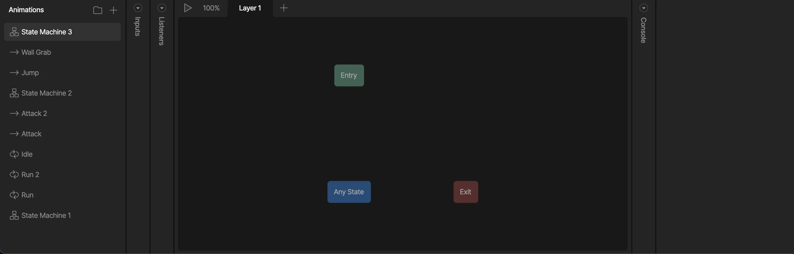
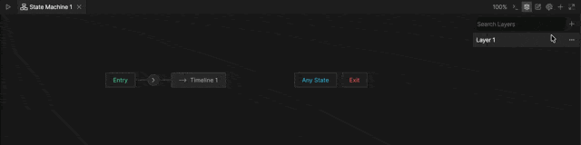
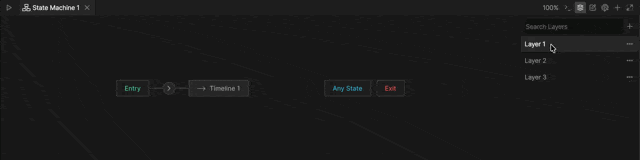
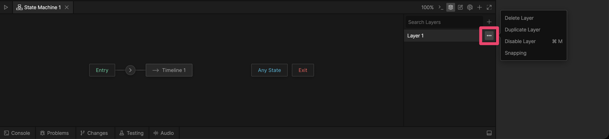

import { YouTube } from '/snippets/youtube.mdx'

A state machine connects your [timelines](/editor/animate-mode/timeline) with logic. It decides which animation plays, when it changes, and how it blends into the next one, based on data, user interaction, or time. This is what makes a Rive graphic interactive, and it's what your app or game controls at runtime.

For example, a button might have Idle, Hover, and Pressed timelines. A state machine plays Idle by default, switches to Hover when the pointer moves over the button, and to Pressed when it's clicked.

<YouTube id="0Hb7SlEW6MI" />

## How a state machine works

A state machine is made of:

- **[States](/editor/state-machine/states)**: what's playing, usually a timeline or a blend of timelines.
- **[Transitions](/editor/state-machine/transitions)**: the connections between states, with conditions that decide when the state machine moves from one state to another.
- **[Layers](#layers)**: each layer is its own graph of states and transitions. Layers play at the same time.

The state machine is driven by:

- **[Data binding](/editor/data-binding/overview)**: transition conditions can check view model properties, so your app can change a value and the state machine responds.
- **[Listeners](/editor/state-machine/listeners)**: respond to pointer, keyboard, and other interactions on the artboard.
- **Time**: a transition can wait until a timeline finishes, or reaches a set point, with [Exit Time](/editor/state-machine/transitions#exit-time).

<Note>
  Older files use [Inputs](/editor/state-machine/inputs) to drive state machines. Use data binding for new work.
</Note>

## Creating a state machine

Every artboard starts with one state machine, and you can add as many as you need. Your app chooses which state machine to play at runtime.

<Steps>
  <Step>
    In the **Animations** list, click **+** and select **State Machine**.
  </Step>
  <Step>
    Select the state machine to open its graph in place of the timeline.
  </Step>
</Steps>

The graph is where you add states and connect them with transitions. A new state machine's graph has the Entry, Any State, and Exit states. See [Default states](/editor/state-machine/states#default-states).

To preview the state machine, click the play button above the graph. It runs on the stage the same way it will at runtime, so you can click, hover, and change bound values to test it.

### Playback header

While a state machine plays, a blue frame surrounds the stage it plays in. The header at the top of the frame shows the state machine's name and two buttons:

- **Stop Playback**: Stops the state machine.
- **Toggle Keyboard Capture**: Sends key presses to the state machine instead of the editor's shortcuts, so you can test [Keyboard listeners](/editor/state-machine/listeners#keyboard). Press **Option+Space** to stop playback while keys are captured.

Click another stage split to move the frame there.

## Graph controls

The buttons above the graph help you navigate and debug it:

- **Zoom**: Shows the graph's current zoom. Click it to type an exact value, zoom in or out, **Zoom to Fit**, or **Zoom to 100%**. Turn on **Snapping** to snap states to the grid while you drag them.
- **Console**: Logs what the state machine does while it plays, including frames, layer and state changes, transitions, input changes, and fired events. The log clears each time playback starts.

## Layers

A layer plays one state at a time. To play more than one animation at once, add more layers. For example, one layer can play a character's idle and walk cycle while another layer plays its blinking.

<YouTube id="7Vb1LosMzwk" />

### Adding a layer

Click **+** in the **Layers** tab.

### Layer order

When two layers animate the same property, the layer lower in the list wins. If your layers animate different properties, their order doesn't matter.

To change the order, drag layers up or down in the **Layers** tab.

<YouTube id="Fc9MutscvAo" />

### Layer options

Click the **...** button next to a layer to open its options.

- **Delete**: Deletes the layer.
- **Duplicate**: Creates a copy of the layer, with its states and transitions.
- **Disable**: Stops the layer from playing without deleting it. Useful for testing one layer at a time. A disabled layer shows a hidden icon in the **Layers** tab; click it to enable the layer again.
- **Snapping**: Turns snapping on or off for states and transitions in the layer's graph.
