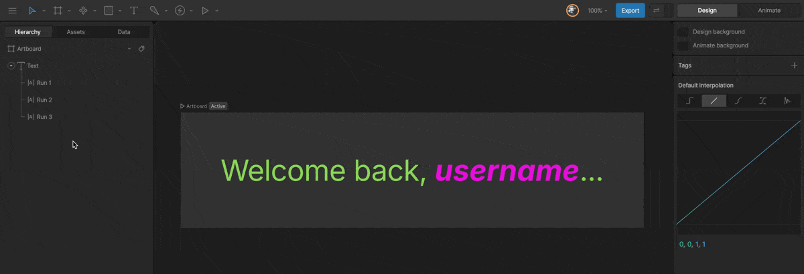
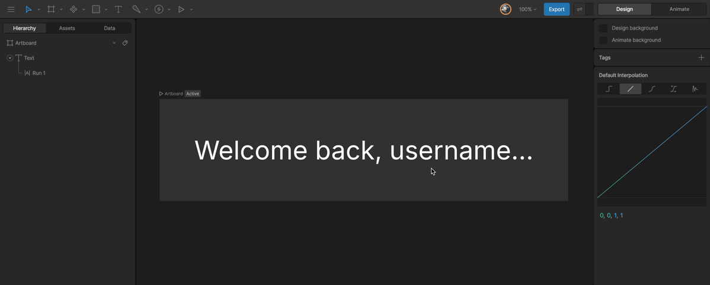
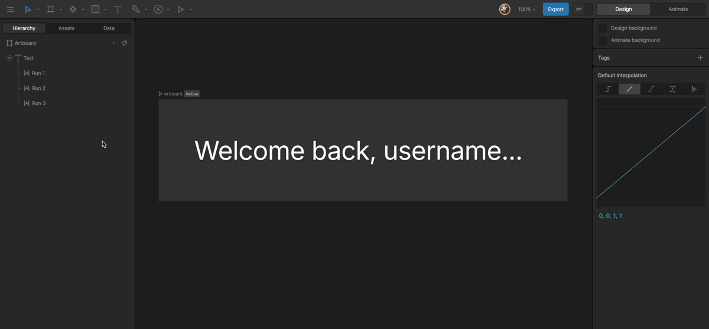

import { YouTube } from '/snippets/youtube.mdx'

<YouTube id="UE23Agn1DZ0" />

Runs allow you break your text up into sections — typically, they're used to apply a variety of styles to a single block of text. Whilst most tools manage text runs behind the scenes, Rive exposes them for greater control when dynamically changing text at runtime.

A Text object acts as a parent that can contain multiple Text Runs as children. Each Text Run represents a specific portion of the Text object and can have its own value and Text Style, allowing it to be targeted at runtime.

<Info>
  A Text Run may only have one Text Style applied at a time.
</Info>

For example, an animation might greet a user with "Welcome back, username". By making "username" its own Text Run, you can give it a different style and [update it at runtime](/runtimes/data-binding) with the user's name.

---

## Creating a Text Run

To create a Run, select the desired portion of text and select the 'Run from Selection' button in the Inspector. You can see Text Runs listed beneath the text object in the hierarchy.

Double click or press `Enter` with the text box selected to start editing text.

Toggle the 'Highlight Text Runs' option in the inspector for a visual guide of your current Text Runs. Hovering a run in the hierarchy also highlights its location within the text.

---

## Managing Text Runs

Select a Text Run in the hierarchy for inspector options:

- **Text Value:** Update the text value for the run. Key this value in [animate mode](/editor/fundamentals/design-vs-animate-mode).
- **Edit Text Run:** Initiate the text editor with the run pre-selected.
- **Merge with Next:** Combine the selected run with the next run.
- **Merge with Previous:** Combine the selected run with the previous run.
- **Delete text Run:** Delete the run and its contents.
- **Style:** Assign one of the Text Styles defined on the text object. Key this value in [animate mode](/editor/fundamentals/design-vs-animate-mode).

---

## Building runs from a list

You can build a Text object's runs from a [view model list](/editor/data-binding/lists). Each item in the list becomes a run, after the runs you created in the editor. The item supplies the run's text and style.

<Steps>
  <Step>
    In the **Data** panel, click **+** and choose **View Model** > **Templates** > **Text Run**. This creates a view model with a **Text Content** property for the run's text and a **Text Style** property for its style.
  </Step>
  <Step>
    Add a list property that uses that view model to the view model your artboard is bound to.
  </Step>
  <Step>
    Select the Text object and use **Bind** at the bottom of the **Text Runs** section in the Inspector to bind the list.
  </Step>
</Steps>

Set an item's **Text Style** to the name of one of the Text object's styles. If no style has that name, the run uses the Text object's first style.

Runs created from a list don't appear in the Inspector, so you can't edit them there. Change the list items instead.
