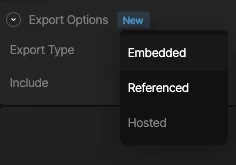
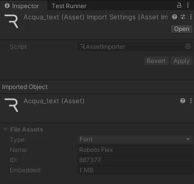
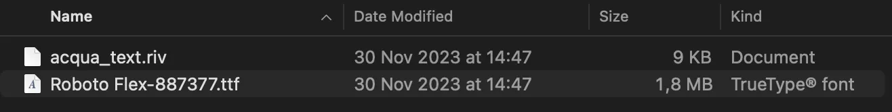
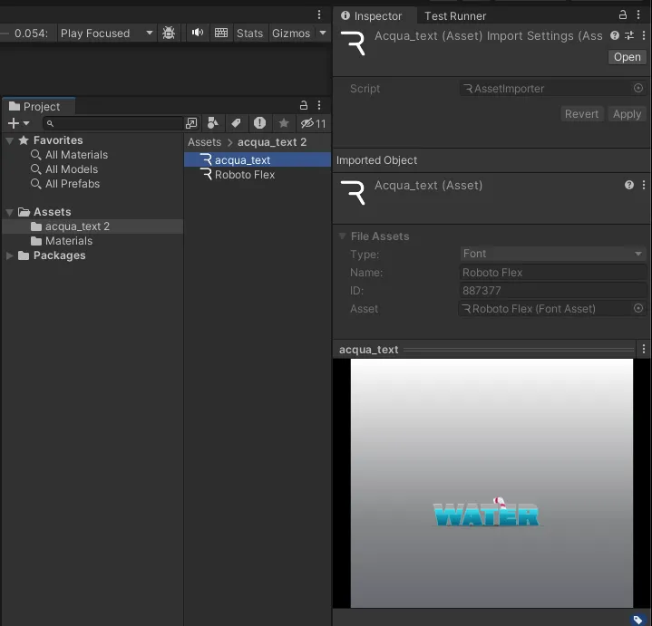
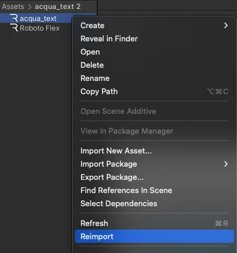
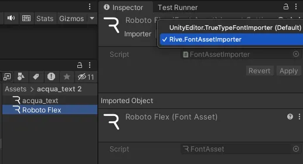
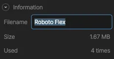

<Note>
 Only **embedded** and **referenced** assets are supported in Rive Unity; **hosted** assets are not currently supported.
</Note>

<Note>
 Only **png** and **jpeg** image assets are supported. Support for **webp** is in progress.
</Note>

## Asset export options

Within the Rive Editor, you can select an asset (for example, an image or font) in the **Asset Panel** and configure the export option for that asset. A Rive file can have a mixture of **embedded**, **referenced**, and **hosted** assets.

**Embedded** assets are included with the exported `.riv` binary file, while **referenced** assets are packaged separately and must be linked at runtime. Using **referenced** assets enables you to reuse the same asset across multiple animation files or in other parts of your game. This reduces the size of your `.riv` file and the resources needed to run your animations that use a shared asset.

### Embedded assets

Any asset marked as embedded will automatically be loaded, and you do not need to do anything to configure the asset.

By selecting the riv file you'll get information on the file's assets in the **Unity Inspector**. The example image above shows an embedded font called "Roboto Flex" with a size of 1MB.

### Referenced assets

Referenced assets need to be linked at runtime. The rive-unity package automatically handles the linking by attempting to find assets within the same directory that match the correct **Name** + **ID** combination. If an asset that matches the criteria is discovered, that asset is automatically converted to a Rive asset and linked.

<Note>
 For an asset to be discoverable and linked, the riv file and asset must be in the same Unity directory.
</Note>

#### Let's take a look at an example

When exporting your runtime file from the Rive Editor, the `.riv` file and referenced assets are exported in a zip.

The extracted zip has an `acqua_text.riv` file with a referenced asset named `Roboto Flex-887377.ttf`. The referenced asset file name breaks down as such:

- **Name:** Roboto Flex
- **ID:** 887377

Selecting both files (or the entire folder) and dragging them into the **Unity Assets** folder will automatically link the embedded font file - if the **Name** + **ID** matches what the `.riv` file expects.

In the **Unity Inspector** for the Rive file, you can note that the **Asset** for the "Roboto Flex" font has been linked, and the **Roboto Flex** font file has also been converted to a Rive asset.

This example automatically converted and linked the font file because the animation and font files were added simultaneously. Alternatively, you can add the asset file first and then the riv file.; this will result in the same outcome.

If an asset was added after the riv file, you'll need to manually reimport the riv file by **right-clicking** it and selecting **Reimport**.

#### Selecting an importer

Alternatively, you can set the desired Importer for an asset by selecting the correct option in the Inspector. This means you can make an asset a Rive Asset or change back an incorrectly converted asset.

#### Sharing assets

Reusing the same asset in your Rive files should result in a consistent **Name** + **ID** generation when exporting from the Rive Editor.

If a matching asset is not found when importing in Unity, there is a fallback to converting and linking a file that matches only the **Name**. You can optionally use this approach to have more control over asset importing, as an asset filename can be renamed in the Rive Editor.

