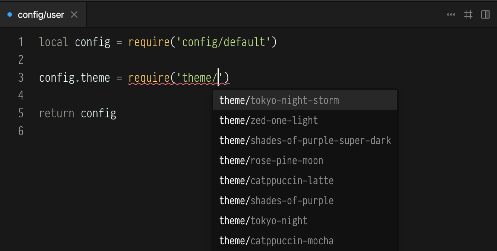

You can customize the appearance and behavior of the Rive code editor by editing its configuration file. Your settings will be reflected in all code editor views for your user account. 

## Opening the configuration

Press **⌘ + ,** on macOS or **Ctrl + ,** on Windows to open the editor configuration.

## Editing the config

The configuration file returns a Lua table. Start with the default configuration and override any settings you want to change.

### Example configuration

```lua
-- Import the default configuration
local config = require('config/default')

config.theme = require('theme/shades-of-purple-super-dark')
config.code.fontSize = 14
config.code.lineHeight = 20
config.code.selectionCornerRadius = 5
config.code.executionTimeoutMs = 2000

return config
```

## Available options

| Option | Description |
|-------|-------------|
| `config.theme` | The editor theme. |
| `config.code.fontSize` | Font size used in the code editor. |
| `config.code.lineHeight` | Height of each line of code. |
| `config.code.selectionCornerRadius` | Corner radius of the selection highlight. |
| `config.code.executionTimeoutMs` | Maximum time a script can run before being stopped. |

<Tip>
  To browse available themes, type:

  `config.theme = require('theme/')`

  The editor will show the full list through autocomplete.

  
</Tip>

## File scripting settings

The settings above apply to the code editor for your account. Each file also has its own scripting settings that control how its scripts are exported. Deselect everything to show the file properties in the Inspector, then find the **Scripting** section.

### Optimization

How much exported scripts are optimized. The default is **Full**.

- **None:** No optimization.
- **Medium:** Safe optimizations that keep debugging intact.
- **Full:** Adds optimizations, such as inlining, that make debugging harder.

### Debug

How much debug info exported scripts keep. The default is **None**.

- **None:** No debug info.
- **Medium:** Line numbers and function names, enough for stack traces.
- **Full:** Also keeps local variable names, which a debugger needs.

To debug scripts in an exported file, raise **Debug** and lower **Optimization**.
