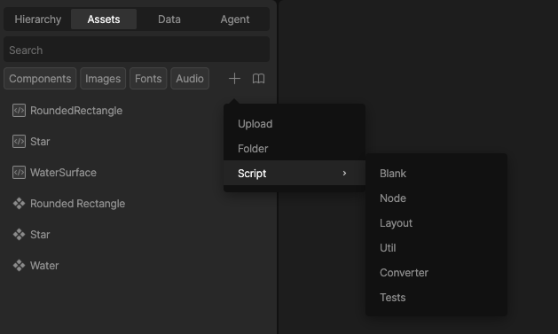
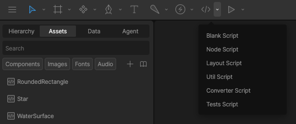
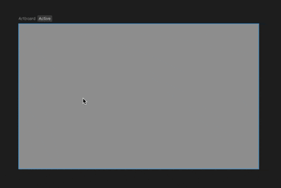

There are two ways to create a new script, from the Assets Panel and with the Scripting tool.

### Creating a Script from the Assets Panel

1. In the Assets Panel, click the `+` button.
2. Choose **Script** and select the [Protocol](/scripting/protocols/overview) (type of script) you'd like to create.

### Creating a Script with the Scripts Tool

1. Select the dropdown icon next to the Script button in the Toolbar
2. Select the [Protocol](/scripting/protocols/overview) (type of script) you'd like to create.

New scripts are saved as Assets and can be found in the Assets Panel.

<Tip>
Use **PascalCase** for script names and update the script’s type name accordingly.

Example: If the script is named `MyConverter`, the main type should also be named `MyConverter`.
</Tip>

## Adding Scripts to your scene

To run [Node](/scripting/protocols/node-scripts) and [Layout](/scripting/protocols/layout-scripts) scripts, they need to be added to the scene.

1. Right-click the artboard you'd like to add your script to and select your script from the menu
2. Position the script object, keeping in mind that the script's position will determine where it's rendered
3. Select the group to set inputs (See [Script Inputs](/scripting/script-inputs))

<Tip>
**Troubleshooting: If you don't see your script in the list:**

1. Make sure your script is in the Assets Panel.
2. Check the [Problems Panel](/scripting/debugging/debug-panel#problems) for issues.
3. Make sure your script returns a function that returns a table with at least an `init` and `draw` function.
</Tip>

## Compiling scripts

When you edit a script, its tab in the viewport shows a dot until the change is compiled. Hover the dot to see **Not Compiled**. Until then, the stage keeps running the last compiled version of the script.

Rive compiles all of the file's scripts when you stop a playing state machine and when you run tests from the [Testing](/scripting/debugging/unit-testing#running-tests) tab.

## Exporting scripts

Not every script in your file ships in the exported `.riv`. Select a script in the Assets Panel and check **Runtime export** in the Inspector to see whether it ships, and why:

- **Exported:** Something in the file uses the script, such as a scripted object on an artboard, or a script that ships requires it.
- **Exported (always):** The script's **Behavior** is set to **Force Export**.
- **Stripped (unreferenced):** Nothing in the file uses the script, and no shipped script requires it.
- **Stripped (test script):** [Test scripts](/scripting/protocols/test-scripts) only run in the editor.
- **Stripped (prevent export):** The script's **Behavior** is set to **Prevent Export**.

Use **Behavior** to override the result. **Force Export** ships the script even when nothing uses it, including a test script. **Prevent Export** always strips it, even when a shipped script requires it.

### Fixing missing required scripts

If a stripped script is required by scripts that ship, the Inspector lists them under **Required by**. Those scripts fail at runtime because the script they require isn't in the `.riv`. To fix this, change the stripped script's **Behavior**: from **Prevent Export** to **Automatic**, or to **Force Export** for a test script. You can also remove the `require` from the scripts that use it.
