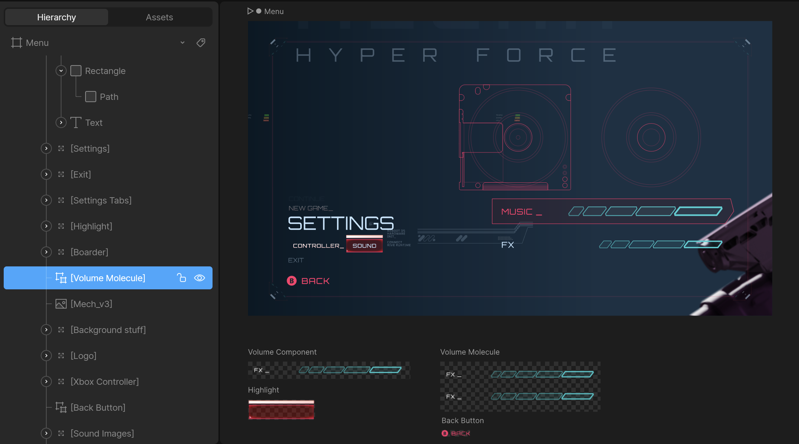
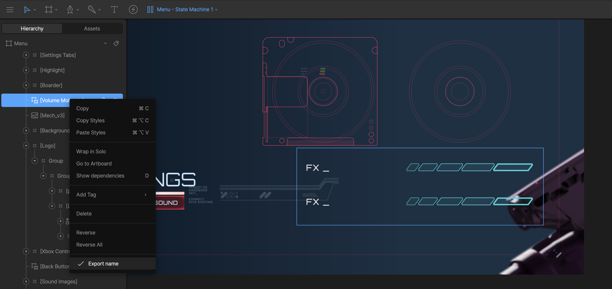
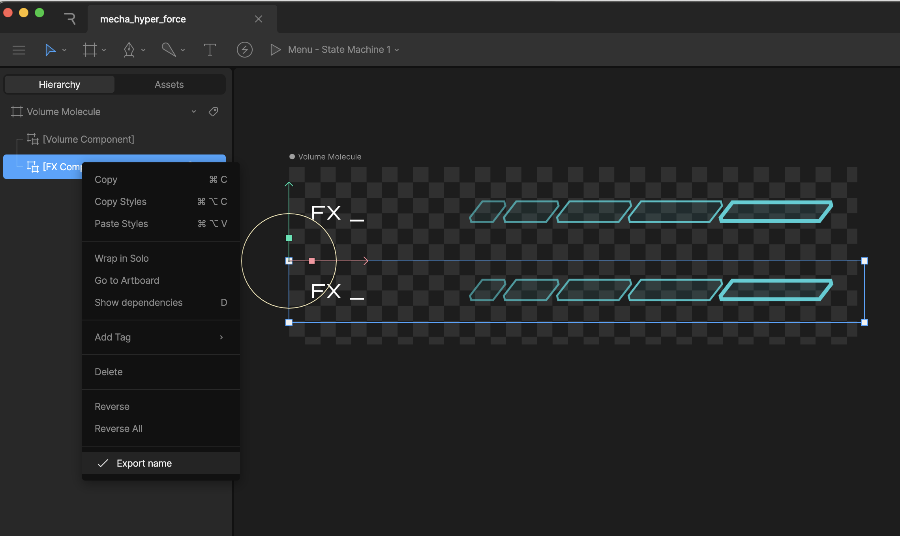

## Nested Inputs

<Warning>
  **⚠️ DEPRECATED FEATURE:** Nested Inputs are part of the legacy Inputs system.
  **Use <Link href="data-binding">Data Binding</Link> instead** for controlling
  component properties at runtime.
</Warning>

You can control the inputs of [Components](/editor/fundamentals/components) at runtime. These inputs are not on the main artboard but on a component. To set a nested input, you need to know the **path** where the input exists at an artboard level.

#### Example

<Warning>
- Use the artboard's unique **hierarchy name**, not the **artboard's name**.
- Do not include the name of the main artboard. In the example above, the path is `Volume Molecule`, not `Menu/Volume Molecule`.
- Ensure the components are [marked as exported](/editor/exporting/exporting-names) in the editor to access them at runtime:

</Warning>

You can go as many components deep as needed. For example, the **Volume Molecule** artboard shown above has two components with the following unique hierarchy names:

- `Volume Component`
- `FX Component`

<Note>
  Once you go more than one component deep the path will be a `/` separated
  string of the unique hierarchy names.
</Note>

If you load in the **Menu** artboard at runtime, and want to get/set an input on the `FX Component` artboard, the path will be `Volume Molecule/FX Component`

<Warning>
  Do not use `/` in the name for your components, as that will break the search
  functionality at runtime.
</Warning>