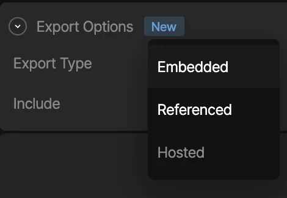

## Methods for loading assets

There are currently three different ways to load assets for your Rive files.

In the Rive editor select the desired asset from the **Assets** tab, and in the inspector choose the desired export option:

