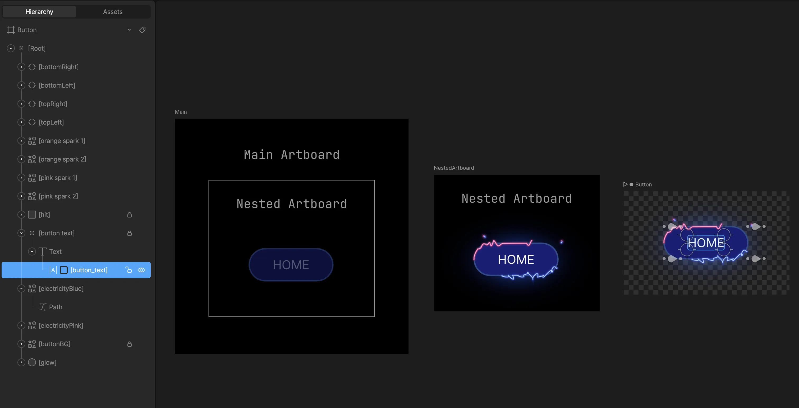
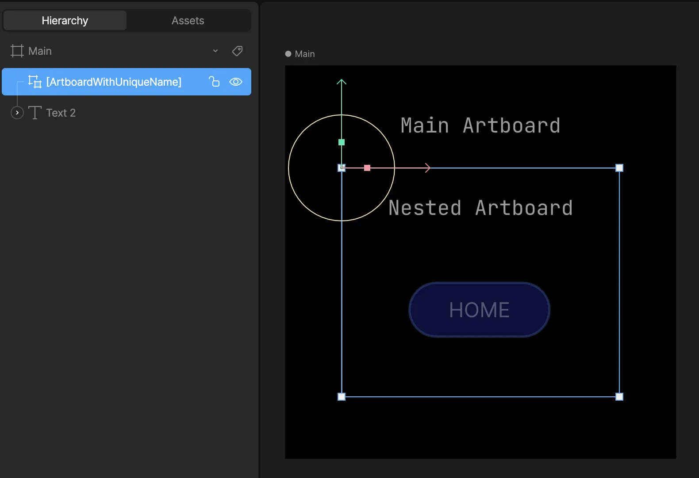
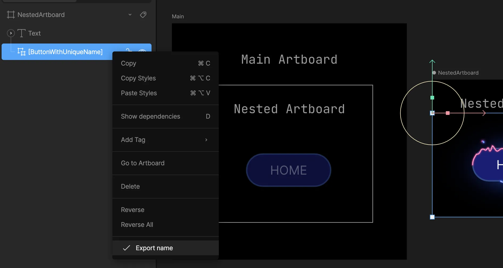

## Read/update nested Text Runs at runtime

<Warning>
  **⚠️ DEPRECATED FEATURE:** Nested Text Runs are part of the legacy Text
  manipulation system. **Use Data Binding instead** for controlling component
  text properties at runtime.
</Warning>

It's possible to set nested text runs at runtime—text that is not on the main artboard but on a [Component](/editor/fundamentals/components). To set a nested text run, you'll need to take note of the path where the input exists at an artboard level.

For example, to get/set the text run named **button_text** on the **Button** artboard, you need to provide the correct path.

_Setting Nested Text Runs_

The artboard names here are:

- **Main** -&gt; **NestedArtboard** -&gt; **Button**

However, the path is determined based on the names set in the hierarchy:

- **ArtboardWithUniqueName** -&gt; **ButtonWithUniqueName**

The path is then: `ArtboardWithUniqueName/ButtonWithUniqueName`

<Warning>
  Be sure to mark the components and text runs as exported.
   
   *Export
  component name*
</Warning>

<Warning>
  Do not use "/" in the name for your components, as that will break the search
  functionality at runtime.
</Warning>